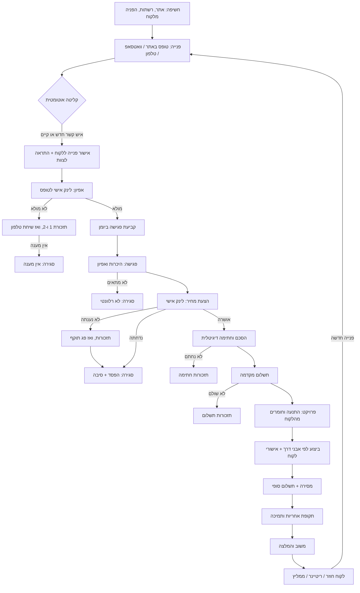
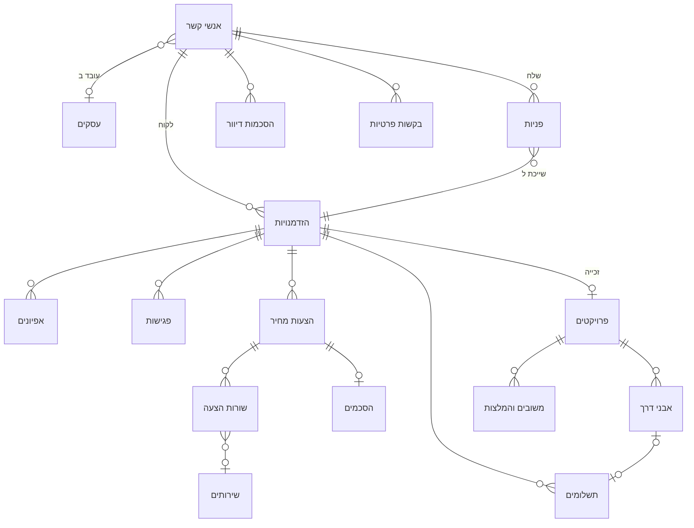

# תכנון מסע הלקוח וה-CRM · iDone Technologies

> **מסמך תכנון בלבד.** שום דבר מכאן עוד לא נבנה: לא טבלאות, לא שדות, לא Workflows ולא קוד. כל שלב בסדר הבנייה (פרק 7) ייבנה רק אחרי אישור.
> מה שמסומן `[להשלמה]` דורש החלטה או מידע ממך. מספרי ימים לתזכורות הם **הצעת ברירת מחדל** שאפשר לשנות, לא נתון.
> הפרק המשפטי (פרק 6) הוא סיכום מקצועי לתכנון המערכת, לא ייעוץ משפטי. כדאי שעורך דין יעבור עליו יחד עם ההסכם ועם מדיניות הפרטיות.

**נכתב:** 29.10.2026 · **גרסה:** 2 (עודכן לפי ההחלטות שלך, טיוטה לאישור)

---

## תוכן

1. [מסע הלקוח](#1-מסע-הלקוח)
2. [מבנה ה-CRM ב-Airtable](#2-מבנה-ה-crm-ב-airtable)
3. [אוטומציות בתוך Airtable](#3-אוטומציות-בתוך-airtable)
4. [התהליך ב-n8n](#4-התהליך-ב-n8n)
5. [מטריצת הודעות](#5-מטריצת-הודעות)
6. [תאימות לחוק](#6-תאימות-לחוק)
7. [סדר בנייה ומעבר](#7-סדר-בנייה-ומעבר)
8. [שאלות פתוחות](#8-שאלות-פתוחות)

---

## 0. מה בדקתי לפני התכנון

- **האתר:** טופס צור קשר (`src/components/ContactForm.astro`) שולח שם, טלפון, מייל, "מה צריך" (אתר / וידאו / אוטומציה / לא בטוח), הודעה, שפה, עמוד ו-User agent. **אין בו תיבת הסכמה לדיוור**, ואין שדות UTM. טופס האפיון (`AssessmentPage.astro`) מזהה את הליד לפי `?lead=rec…` מתוך ה-URL. עמוד הפרטיות קצר מאוד ולא מכסה את מה שתיקון 13 דורש בהודעה על איסוף מידע (פרק 6).
- **ה-Base הנוכחי iDone CRM** (`appln4aJd00Ai38eL`): ארבע טבלאות (לידים, הסרות מדיוור, יומן שליחות, אפיונים). כל פנייה היא רשומת "ליד" אחת, כך שאין הפרדה בין **אדם**, **פנייה** ו**עסקה**. לקוח שחוזר אחרי שנה ייפתח כליד חדש, וההיסטוריה שלו תתפצל. את ה-Base הישן `appc7rNKTajWHy8xA` לא קראתי, כמו שביקשת.
- **ה-Workflow New Lead** (24 צמתים): בודק את הטופס, יוצר ליד, בונה לינקים אישיים לפי מזהה הרשומה (`rec…`), בודק הסרות, ממלא תבניות מייל מהאתר, שולח מייל ווואטסאפ ללקוח ולצוות ורושם ביומן. **שתי נקודות לתכנון החדש:** (1) הלינקים הציבוריים (אפיון, הסרה) בנויים על מזהה הרשומה ב-Airtable. זה עובד, אבל מזהה רשומה הוא לא סוד, ומי שמחזיק לינק אחד יכול לנחש מבנה. בתכנון החדש כל לינק ציבורי יעבוד עם טוקן אקראי. (2) הבדיקה מול רשימת ההסרות קורית בתוך כל Workflow בנפרד. בתכנון החדש היא תעבור לתת-Workflow אחד שכל הודעה עוברת דרכו.
- **אוטומציות Airtable דרך ה-MCP:** `create_automation` יוצר **טיוטה בלבד**. את ההפעלה אתה עושה ידנית בממשק של Airtable. טריגרים נתמכים: רשומה נוצרה / עודכנה / עומדת בתנאים / נכנסה ל-View, תזמון, טופס ו-Webhook. פעולות: יצירה ועדכון רשומות, חיפוש, מייל (כולל Gmail), Slack, AI, וסקריפט מותאם שיכול לשלוח בקשת `fetch` החוצה. אין פעולת וואטסאפ. הכלים מאפשרים גם ליצור Interfaces ועמודים (`create_interface`, `create_page`). המסקנה בפרק 3.

### 0.1 החלטות שהתקבלו (גרסה 2)

| נושא | החלטה | מה זה משנה בתכנון |
|---|---|---|
| יומן פגישות | Cal.com, החשבון הקיים (`idone-automations/30min`, מהאתר הקודם) | WF-04 מקבל Webhooks של Cal.com (נקבעה, שונתה, בוטלה). הלינק ללקוח כולל את טוקן ההזדמנות, כך שהפגישה מתקשרת אליה בלי לחפש לפי מייל. |
| חשבוניות וסליקה | עדיין אין | נשאר `[להשלמה]`. עד אז התשלומים מנוהלים ידנית ב-Airtable (שלב 11). |
| חתימה דיגיטלית | עמוד משלנו באתר | `/he/sign/` ו-`/en/sign/`, עם גיבוב הנוסח, זמן, IP ודפדפן. |
| PDF | כן, מעוצב, רשמי, נשלח במייל, **דרך Google Docs** | תבניות של הצעה והסכם ב-Google Docs, בעיצוב המותג, בעברית (RTL) ובאנגלית. n8n מעתיק תבנית, ממלא אותה ומייצא ל-PDF (SUB-06). |
| Google | החשבון שמחובר היום ל-n8n | אותו חשבון Google של Gmail. צריך להוסיף לו ב-n8n חיבור (Credential) ל-Google Drive ול-Google Docs, כי החיבור הקיים הוא ל-Gmail בלבד. |
| וואטסאפ | GreenAPI | GreenAPI מתחבר לוואטסאפ דרך WhatsApp Web, כלומר זה לא ה-API הרשמי של Meta. **השלכה:** שליחה בהיקף גדול או שיווקית מגדילה את הסיכון לחסימת המספר. לכן הודעות שיווקיות ייצאו רק במייל, ובוואטסאפ רק הודעות שירות. **התראות על הודעות נכנסות עוד לא מופעלות.** בונים את הקליטה ("הסר") כאילו הן פעילות, ומפעילים אותן ב-GreenAPI בשלב 4. |
| היקף | נמוך כרגע | 1,000 הרשומות מספיקות. WF-13 יתריע ב-800. |
| Airtable | תוכנית חינמית | **שינוי מהותי במבנה, ראה 2.1.** לפי מה שמפורסם, בתוכנית החינמית יש 1,000 רשומות לכל Base (סך כל הטבלאות), 100 הרצות אוטומציה בחודש ו-1GB קבצים מצורפים ל-Base. `[לאמת בעמוד התמחור של Airtable, כולל מגבלת קריאות API בחודש, אם יש]`. |
| קבצי פרויקט | Git לקוד ולאתר, Drive למסמכים | בפרויקט שני שדות: מאגר קוד (GitHub) ותיקיית מסמכים (Google Drive). כל ה-PDF-ים (הצעות, הסכמים חתומים) נשמרים ב-Drive, וב-Airtable נשמר רק לינק. |
| דיוור שיווקי | רק בהסכמה מפורשת, גם ללקוחות | בוטל "חריג לקוח קיים". בעמוד החתימה תהיה תיבת הסכמה לא מסומנת, כמו בטופס באתר. |
| מספר זהות | לא נאסף | השדה ירד מהסכמים. |
| שמירת מידע | שנה, באכיפה בפועל | WF-13 מוחק אוטומטית (לא רק מציע). הפירוט בסעיף 6.2. |
| בקשות פרטיות | מענה תוך שבוע, בדרך כלל יום עסקים אחד | מועד יעד: 7 ימים. יעד שירות: יום עסקים אחד, עם התראה לצוות. |
| כתובת בהודעות שיווקיות | לא | שם השולח, מייל ולינק הסרה בלבד. |
| החלטות עסקיות | יוחלטו יחד בהמשך | נשארות `[להשלמה]` בפרק 8. לא חוסמות את שלבים 1–8. |

---

## 1. מסע הלקוח

### 1.1 תרשים זרימה

### 1.2 עקרונות שחוזרים בכל השלבים

- **אדם אחד, הרבה עסקאות.** כל אדם נשמר פעם אחת בטבלת אנשי קשר. כל פנייה נרשמת בנפרד, וכל צורך עסקי הוא "הזדמנות" משלו. לקוח חוזר מקבל הזדמנות חדשה עם כל ההיסטוריה שלו.
- **שלב אחד מוביל.** השדה "שלב" בהזדמנות הוא מקור האמת למכירה, והשדה "סטטוס" בפרויקט הוא מקור האמת לביצוע. כל תזכורת אוטומטית נגזרת מהם ומהזמן שעבר מאז השינוי האחרון.
- **אפשר תמיד לעצור.** בכל הזדמנות יש תיבה "עצור תזכורות אוטומטיות". כשהלקוח כתב שהוא צריך זמן, מסמנים אותה, והמערכת מפסיקה לשלוח.
- **מקסימום שתי תזכורות אוטומטיות לכל שלב**, ואחריהן משימה לצוות (שיחה) או סגירה מנומסת. זה גם מכבד את הלקוח וגם שומר על הודעות שירות בגבולות שלהן (פרק 6).
- **כל לינק ללקוח הוא אישי ועם טוקן**, ופותח עמוד באתר בשפה של הלקוח.

### 1.3 השלבים בפירוט

#### שלב 1 · חשיפה

| | |
|---|---|
| **הלקוח** | רואה את iDone באתר, ברשתות, בגוגל או מפי לקוח שהמליץ. |
| **הצוות** | תוכן ותיק עבודות (מחוץ ל-CRM). |
| **אוטומטי** | האתר שומר את פרמטרי ה-UTM ואת העמוד שממנו הגיע הלקוח, ושולח אותם עם הטופס. הלינק להמלצה מלקוח כולל `?ref=` עם הטוקן של הממליץ. |
| **ידני** | אין. |
| **מעבר לשלב הבא** | שליחת טופס, הודעת וואטסאפ או שיחה. |
| **אם נתקע** | לא רלוונטי. |

#### שלב 2 · פנייה

| | |
|---|---|
| **הלקוח** | ממלא טופס (שם, טלפון, מייל, מה צריך, הודעה, **תיבת הסכמה לדיוור, לא מסומנת מראש**). רואה הודעת הצלחה, ותוך דקה מקבל מייל ווואטסאפ עם אישור ולינק לאפיון. |
| **הצוות** | מקבל התראה במייל ובוואטסאפ עם כל הפרטים ולינק לרשומה. תוך יום עסקים: שיחה קצרה או הודעה אישית. |
| **אוטומטי** | נרמול טלפון ומייל, איתור איש קשר קיים (לפי מייל או טלפון), יצירת פנייה, יצירת הזדמנות (או צירוף להזדמנות פתוחה קיימת), תיעוד הסכמה אם סומנה, שליחת אישור, התראה לצוות, יצירת משימה "ליצור קשר" ליום העסקים הבא. |
| **ידני** | פנייה שהגיעה בטלפון או בוואטסאפ ישיר נרשמת ידנית בטופס פנימי ב-Interface. אותו Workflow קולט אותה. |
| **מעבר לשלב הבא** | אוטומטית לשלב "אפיון נשלח" ברגע שהלינק יצא. |
| **אם נתקע** | אם הצוות לא סימן "נוצר קשר" עד סוף יום העסקים הבא, המשימה מופיעה באדום בסיכום היומי. |

#### שלב 3 · אפיון

| | |
|---|---|
| **הלקוח** | פותח לינק אישי לטופס אפיון (שם ופרטים כבר ממולאים), עונה על שאלות לפי השירות, ובסיום רואה לינק לקביעת פגישה. |
| **הצוות** | קורא את האפיון לפני הפגישה. |
| **אוטומטי** | שמירת האפיון וקישורו להזדמנות, מעבר לשלב "אפיון התקבל", מייל תודה ללקוח עם לינק ליומן, התראה לצוות עם סיכום. |
| **ידני** | אם הלקוח מעדיף שיחה במקום טופס, הצוות ממלא את האפיון בשיחה, באותו טופס. |
| **מעבר לשלב הבא** | קביעת פגישה ביומן. |
| **אם נתקע** | לא מולא תוך 2 ימי עסקים: תזכורת בוואטסאפ. תוך 5: תזכורת במייל. תוך 7: משימה לצוות "להתקשר". תוך 14 בלי מענה: הודעת סגירה מנומסת ("סוגרים את הפנייה, אפשר לחזור אלינו בכל זמן") וסגירה עם סיבה "אין מענה". |

#### שלב 4 · פגישה

| | |
|---|---|
| **הלקוח** | בוחר מועד ב-Cal.com, מקבל אישור עם קובץ יומן ולינק לשיחה, ותזכורות לפני הפגישה. |
| **הצוות** | מנהל את הפגישה. אחריה כותב סיכום ומחליט: הצעת מחיר, לא מתאים, או פגישה נוספת. |
| **אוטומטי** | יצירת רשומת פגישה מהיומן, מעבר לשלב "פגישה נקבעה", אישור ללקוח, תזכורות 24 שעות ושעתיים לפני, ביטול או שינוי מועד מתעדכנים מהיומן. שעה אחרי מועד הפגישה: משימה לצוות "לכתוב סיכום ולעדכן שלב". |
| **ידני** | סיכום פגישה, שלב "פגישה התקיימה" או "לא הגיע", החלטה על המשך. שליחת סיכום ללקוח (אופציונלי, מתבנית). |
| **מעבר לשלב הבא** | הצוות פותח הצעת מחיר. |
| **אם נתקע** | הלקוח לא קבע פגישה תוך 3 ימי עסקים אחרי האפיון: תזכורת אחת בוואטסאפ, ואז משימה לצוות. לא הגיע לפגישה: הודעה אוטומטית עם לינק לקביעה מחדש. |

#### שלב 5 · הצעת מחיר

| | |
|---|---|
| **הלקוח** | מקבל לינק אישי לעמוד הצעה באתר (בשפה שלו): היקף, מה לא כלול, לוח זמנים, מחיר, תנאי תשלום ותוקף. יכול לאשר בלחיצה, לבקש שינוי או לדחות. אפשר גם להוריד PDF. |
| **הצוות** | בונה את ההצעה ב-Airtable משורות מתוך קטלוג השירותים, ולוחץ "שליחה". מקבל התראה כשהלקוח פתח, אישר או דחה. |
| **אוטומטי** | יצירת טוקן, שליחה במייל ובוואטסאפ, תיעוד צפייה ראשונה, תיעוד אישור (שם, זמן, IP) או דחייה (עם סיבה), מעבר שלב, התראה לצוות. |
| **ידני** | בניית ההצעה, תמחור, שינויים וגרסה חדשה. |
| **מעבר לשלב הבא** | אישור ההצעה פותח אוטומטית את ההסכם לחתימה. |
| **אם נתקע** | לא נפתחה תוך 2 ימי עסקים: תזכורת. נפתחה ולא נענתה תוך 5: תזכורת שנייה. יומיים לפני פקיעת התוקף: משימה לצוות להתקשר. פג התוקף: ההצעה מסומנת "פג תוקף", ההזדמנות נשארת פתוחה עד שהצוות מחליט. |

#### שלב 6 · הסכם וחתימה

| | |
|---|---|
| **הלקוח** | מקבל לינק לעמוד חתימה באתר, עם הסכם השירות (מבוסס `docs/02-service-agreement-draft.md`) ופרטי ההצעה המאושרת. ממלא פרטים לחשבונית, יכול לסמן הסכמה לתוכן שיווקי (לא מסומנת מראש, לא חובה), חותם, ומקבל במייל PDF חתום ומעוצב. |
| **הצוות** | בודק ומאשר (חתימה של הספק). |
| **אוטומטי** | הפקת המסמך מהנוסח העדכני, שמירת גיבוב (hash) של הנוסח שנחתם, תיעוד החתימה, PDF חתום לשני הצדדים, מעבר שלב, פתיחת דרישת תשלום מקדמה. |
| **ידני** | חתימת הספק, אם בוחרים בזה (אפשר גם חתימה אוטומטית בשם הספק). |
| **מעבר לשלב הבא** | חתימה מלאה. |
| **אם נתקע** | לא נחתם תוך 2 ימי עסקים: תזכורת. תוך 5: תזכורת שנייה ומשימה לצוות. |

#### שלב 7 · תשלום

| | |
|---|---|
| **הלקוח** | מקבל דרישת תשלום עם לינק לתשלום (`[להשלמה: מערכת חשבוניות וסליקה]`), ואחרי התשלום מקבל קבלה או חשבונית מס/קבלה. |
| **הצוות** | מוודא שהכסף נכנס (בהעברה בנקאית: מאשר ידנית). |
| **אוטומטי** | יצירת רשומות תשלום לפי תנאי ההצעה (מקדמה, אבני דרך, סופי, או ריטיינר חודשי), שליחת דרישת תשלום, קליטת אישור תשלום ממערכת החשבוניות, עדכון סטטוס. **תשלום המקדמה הופך את ההזדמנות לפרויקט.** |
| **ידני** | אישור העברה בנקאית, טיפול בחריגים. |
| **מעבר לשלב הבא** | תשלום מקדמה, או אישור ידני של הצוות להתחיל בלי מקדמה. |
| **אם נתקע** | ביום היעד: תזכורת. 3 ימים אחריו: תזכורת שנייה. 7 ימים: משימה לצוות. בהתאם לסעיף 3.3 בהסכם, הצוות מחליט אם להשהות עבודה (ההחלטה ידנית בלבד). |

#### שלב 8 · ביצוע הפרויקט

| | |
|---|---|
| **הלקוח** | מקבל הודעת התנעה עם רשימת החומרים והגישות שצריך למסור (לפי סוג השירות). מקבל לינק לאישור כל אבן דרך: "מאשר" או "יש הערות". |
| **הצוות** | עובד לפי אבני הדרך, מעדכן סטטוס, שולח לאישור. |
| **אוטומטי** | יצירת פרויקט ואבני דרך מתוך תבנית השירות, הודעת התנעה, תזכורות על חומרים חסרים, שליחת אבן דרך לאישור, תיעוד האישור, ספירת סבבי תיקונים מול מה שכלול בהצעה, דרישת תשלום של אבן דרך שאושרה (אם זה מודל התשלום). |
| **ידני** | העבודה עצמה, עדכוני התקדמות, תיקונים. |
| **מעבר לשלב הבא** | כל אבני הדרך אושרו והפרויקט מסומן "מוכן למסירה". |
| **אם נתקע** | "ממתין ללקוח" (חומרים או אישור) יותר מ-3 ימי עסקים: תזכורת. 7: תזכורת שנייה ומשימה לצוות. לפי סעיף 5.2 בהסכם, עיכוב של הלקוח מאריך את לוח הזמנים, והמערכת שומרת את מספר הימים שהפרויקט חיכה ללקוח. כשסבבי התיקונים הכלולים נגמרים, הצוות מקבל התראה (תוספת נתמחרת לפי סעיף 1.3). |

#### שלב 9 · מסירה

| | |
|---|---|
| **הלקוח** | מקבל מסמך מסירה: לינקים, גישות, קבצים, הסבר שימוש, מה כלול בתקופת האחריות ועד מתי. מקבל דרישת תשלום סופי. |
| **הצוות** | מעביר בעלות על חשבונות ודומיינים ללקוח (סעיף 4.2 בהסכם), מוסר קבצים. |
| **אוטומטי** | מייל מסירה מתבנית, דרישת תשלום סופי, חישוב סוף תקופת האחריות, תזמון בקשת משוב. |
| **ידני** | מילוי פרטי המסירה, העברת גישות. |
| **מעבר לשלב הבא** | תשלום סופי. הפרויקט עובר ל"בתקופת אחריות". |
| **אם נתקע** | תזכורות תשלום כמו בשלב 7. |

#### שלב 10 · שימור והמלצות

| | |
|---|---|
| **הלקוח** | 7 ימים אחרי המסירה מקבל שאלון משוב קצר. אם הציון גבוה: בקשה להמלצה ובקשה לאשר פרסום שלה, ולינק לביקורת בגוגל (`[להשלמה: האם יש פרופיל עסק בגוגל]`). לקראת סוף האחריות: הודעת שירות שהאחריות מסתיימת ועד מתי. הצעה לריטיינר תמיכה נשלחת רק למי שהסכים לתוכן שיווקי. |
| **הצוות** | עונה למשוב שלילי בשיחה אישית, מחליט אילו המלצות לפרסם באתר. |
| **אוטומטי** | שאלון משוב, תיעוד ההמלצה ואישור הפרסום, לינק הפניה אישי ללקוח, ייחוס פנייה חדשה לממליץ, הודעת סוף אחריות. |
| **ידני** | פרסום המלצה באתר (רק עם אישור מתועד), תודה לממליץ. |
| **מעבר לשלב הבא** | פנייה חדשה של אותו לקוח או של מי שהוא הפנה חוזרת לשלב 2, עם כל ההיסטוריה. |
| **אם נתקע** | המשוב לא מולא: תזכורת אחת אחרי 5 ימים ולא יותר. **כל הודעה שמציעה שירות נוסף היא שיווקית**, ויוצאת רק לפי פרק 6. |

### 1.4 סגירת הזדמנות

כל הזדמנות נסגרת באחד מארבעה מצבים: **זכייה** (הפכה לפרויקט), **הפסד** (עם סיבה), **לא רלוונטי** (ספאם, לא בתחום, טעות) או **מוקפא** (הלקוח ביקש לחזור אליו במועד מסוים, עם תאריך "לחזור ב"). הזדמנות מוקפאת חוזרת לסיכום היומי בתאריך שנקבע.

---

## 2. מבנה ה-CRM ב-Airtable

### 2.1 החלטות מבנה

- **אותו Base** (`iDone CRM`), טבלאות חדשות לצד הישנות. החיבורים ב-n8n וההרשאות כבר קיימים, והמעבר יהיה הדרגתי (פרק 7). בסוף המעבר הטבלאות הישנות יקבלו את הקידומת "ארכיון ·" ויימחקו רק באישורך.
- **שמות בעברית** לטבלאות, לשדות ולערכים, כמו היום. ב-n8n משתמשים במזהי השדות (`fld…`) ולא בשמות, כדי ששינוי שם לא ישבור Workflow.
- **טוקן אקראי לכל לינק ציבורי** (איש קשר, הזדמנות, הצעה, הסכם, אבן דרך, משוב). n8n יוצר אותו (UUID), ו-Airtable מחשב ממנו את הלינק בנוסחה.
- **מעט שדות חובה.** Airtable לא אוכף חובה ברמת הטבלה, אז n8n בודק את מה שהוא כותב, וה-Interfaces מגדירים שדות חובה בטפסים.
- **התוכנית החינמית של Airtable קובעת כמה החלטות:**
  - **1,000 רשומות ל-Base, בכל הטבלאות יחד.** לכן מה שגדל מהר ולא צריך עריכה ידנית לא נשמר ב-Airtable: **יומן ההודעות** והנתונים הגולמיים של כל טופס עוברים ל-**Data Tables של n8n** (בשרת שלך, בלי מגבלת רשומות של Airtable). ב-Airtable נשארים רק שדות סיכום, כמו "הודעה אחרונה" ו"תזכורות בשלב הנוכחי".
  - **הערכה גסה:** ליד שלא התקדם תופס כ-4–6 רשומות (איש קשר, פנייה, הזדמנות, אפיון, משימה, הסכמה). לקוח שהגיע עד פרויקט תופס עוד כ-15 (הצעה ושורות, הסכם, תשלומים, פרויקט, אבני דרך, משוב). עם מחיקה אחרי שנה (6.2), זה מספיק לכמה מאות פניות בשנה (ההיקף הצפוי כרגע נמוך, אז זה מספיק). WF-13 סופר את הרשומות כל חודש, ומתריע ב-800.
  - **100 הרצות אוטומציה בחודש:** לא בונים אוטומציות ב-Airtable (פרק 3). פעולות צוות נשלחות ל-n8n בכפתור.
  - **1GB קבצים מצורפים:** אין קבצים מצורפים ב-Airtable. PDF-ים, חתימות וקבצי פרויקט נשמרים ב-Google Drive, וב-Airtable נשמר לינק.
  - **מעט קריאות API:** n8n לא בודק את Airtable כל כמה דקות. הוא נכנס רק כשקורה משהו (טופס, כפתור, Webhook), ופעם ביום לתזכורות.
  - **Views:** לפי מה שידוע לי, תצוגות Timeline ו-Gantt לא כלולות בתוכנית החינמית. במקומן: Calendar ו-Grid ממוין לפי תאריך `[לאמת]`.

### 2.2 מפת טבלאות וקשרים

| # | טבלה | תפקיד | מתקשרת אל |
|---|---|---|---|
| 1 | אנשי קשר | כל אדם, פעם אחת | עסקים, פניות, הזדמנויות, הסכמות דיוור, משובים, בקשות פרטיות, אנשי קשר (הפניות) |
| 2 | עסקים | הארגון של הלקוח ופרטי חשבונית | אנשי קשר, הזדמנויות, פרויקטים |
| 3 | פניות | כל שליחת טופס או פנייה, כפי שהגיעה | אנשי קשר, הזדמנויות |
| 4 | הזדמנויות | צנרת המכירה, צורך עסקי אחד | כמעט הכול |
| 5 | אפיונים | תשובות טופס האפיון | הזדמנויות |
| 6 | פגישות | כל פגישה עם לקוח | הזדמנויות, פרויקטים |
| 7 | משימות | מעקבים ומשימות לצוות | הזדמנויות, פרויקטים, אבני דרך |
| 8 | שירותים | קטלוג שירותים ומחירי בסיס | שורות הצעה |
| 9 | הצעות מחיר | הצעה וגרסאות שלה | הזדמנויות, שורות הצעה, הסכמים, תשלומים |
| 10 | שורות הצעה | פריטים בהצעה | הצעות מחיר, שירותים |
| 11 | הסכמים | הסכם שירות וחתימה | הזדמנויות, הצעות מחיר |
| 12 | תשלומים | דרישות תשלום, חשבוניות ותקבולים | הזדמנויות, הצעות מחיר, פרויקטים, אבני דרך |
| 13 | פרויקטים | ביצוע ומסירה | הזדמנויות, עסקים, אבני דרך, תשלומים, משובים |
| 14 | אבני דרך | שלבים בפרויקט ואישורי לקוח | פרויקטים, תשלומים, משימות |
| 15 | משובים והמלצות | משוב, המלצה ואישור פרסום | אנשי קשר, פרויקטים |
| 16 | הסכמות דיוור | יומן הסכמות והסרות (ראיה משפטית) | אנשי קשר |
| 17 | יומן הודעות (**ב-n8n Data Table**, לא ב-Airtable) | כל הודעה שיצאה או נכנסה | שומר את מזהי הרשומות של איש הקשר, ההזדמנות והפרויקט |
| 18 | תבניות הודעות | נוסחי וואטסאפ ונושאי מייל בשתי השפות | יומן הודעות |
| 19 | בקשות פרטיות | עיון, תיקון, מחיקה והסרה לפי חוק | אנשי קשר |

### 2.3 שדות לכל טבלה

סימונים: **ראשי** = השדה הראשי של הטבלה. **n8n** = רק n8n כותב לשדה. **חישוב** = נוסחה, rollup, lookup, count או שדה מערכת.

#### 1. אנשי קשר

| שדה | סוג | ערכים / נוסחה / הערה |
|---|---|---|
| שם מלא | טקסט קצר · **ראשי** | |
| שם פרטי | טקסט קצר | n8n מפצל מהשם המלא, לשימוש בהודעות. אפשר לתקן ידנית. |
| מייל | מייל | n8n שומר באותיות קטנות. מפתח לזיהוי כפילויות. |
| טלפון | טלפון | כפי שהלקוח כתב. |
| טלפון בינלאומי | טקסט קצר · n8n | `9725XXXXXXXX` מתוך Israeli Phone Formatter. מפתח לזיהוי כפילויות ולוואטסאפ. |
| שפה מועדפת | בחירה יחידה | עברית · English |
| עסק | קישור → עסקים | |
| תפקיד | טקסט קצר | |
| מקור ראשון | בחירה יחידה | אתר: טופס צור קשר · אתר: וואטסאפ · הפניה מלקוח · Instagram · TikTok · Facebook · LinkedIn · YouTube · Google · שיחת טלפון · אחר |
| הופנה על ידי | קישור → אנשי קשר | הממליץ. |
| הפנה את | קישור → אנשי קשר | הצד ההפוך של "הופנה על ידי". |
| מצב דיוור במייל | בחירה יחידה · n8n | אין הסכמה · הסכים · הוסר |
| מצב דיוור בוואטסאפ | בחירה יחידה · n8n | אין הסכמה · הסכים · הוסר |
| חסימה מלאה | תיבת סימון · n8n | ביקש שלא לפנות אליו בכלל, גם לא בהודעות שירות. |
| שלב במחזור החיים | נוסחה · חישוב | `IF({פרויקטים פעילים}>0,"לקוח פעיל",IF({פרויקטים שהושלמו}>0,"לקוח עבר",IF({הזדמנויות פתוחות}>0,"ליד פתוח","ליד סגור")))` |
| הזדמנויות | קישור → הזדמנויות | |
| הזדמנויות פתוחות | rollup · חישוב | `SUM(values)` על "פתוחה?" (1/0) בהזדמנויות. |
| פרויקטים פעילים | rollup · חישוב | `SUM(values)` על "פרויקט פעיל?" בהזדמנויות. |
| פרויקטים שהושלמו | rollup · חישוב | `SUM(values)` על "פרויקט הושלם?" בהזדמנויות. |
| סה"כ שולם | rollup · חישוב | `SUM(values)` על "סה"כ שולם" בהזדמנויות. |
| פניות | קישור → פניות | |
| פנייה ראשונה | rollup · חישוב | `MIN(values)` על "תאריך" בפניות. |
| הודעה אחרונה | תאריך ושעה · n8n | n8n מעדכן בכל שליחה (היומן עצמו ב-n8n). |
| פעילות אחרונה | נוסחה · חישוב | `MAX({הודעה אחרונה},{פנייה אחרונה},{עודכן ב})`. ממנה נספרת השנה למחיקה (6.2). |
| פנייה אחרונה | rollup · חישוב | `MAX(values)` על "תאריך" בפניות. |
| שמירה מעבר לשנה | תיבת סימון | הצוות מסמן כשיש סיבה לשמור (למשל לקוח בפרויקט פעיל). WF-13 מדלג. |
| סיבת שמירה | טקסט קצר | חובה כשהתיבה מסומנת. |
| הסכמות דיוור | קישור → הסכמות דיוור | |
| משובים והמלצות | קישור → משובים והמלצות | |
| בקשות פרטיות | קישור → בקשות פרטיות | |
| טוקן | טקסט קצר · n8n | UUID. |
| לינק העדפות דיוור | נוסחה · חישוב | `"https://www.idone.co.il/"&IF({שפה מועדפת}="English","en","he")&"/preferences/?t="&{טוקן}` |
| לינק הפניה | נוסחה · חישוב | `"https://www.idone.co.il/he/?ref="&{טוקן}` |
| מצב רשומה | בחירה יחידה | פעיל · אנונימי (אחרי מחיקה לפי בקשה) |
| מזהה ישן | טקסט קצר | מזהה הרשומה בטבלת "לידים" הישנה, למעבר ולתמיכה בלינקים ישנים. |
| הערות | טקסט ארוך | |
| נוצר ב / עודכן ב | זמן יצירה / שינוי אחרון · חישוב | |

#### 2. עסקים

| שדה | סוג | ערכים / נוסחה / הערה |
|---|---|---|
| שם העסק | טקסט קצר · **ראשי** | |
| תחום | טקסט קצר | |
| גודל צוות | בחירה יחידה | רק אני · 2–5 · 6–20 · 21 ומעלה (כמו בטופס האפיון) |
| אתר | URL | |
| מספר עוסק / ח.פ | טקסט קצר | נאסף רק בשלב ההסכם, לצורך חשבונית. |
| שם לחשבונית | טקסט קצר | |
| כתובת לחשבונית | טקסט ארוך | |
| מייל לחשבוניות | מייל | |
| אנשי קשר | קישור → אנשי קשר | |
| איש קשר לחיוב | קישור → אנשי קשר | |
| הזדמנויות | קישור → הזדמנויות | |
| פרויקטים | קישור → פרויקטים | |
| סה"כ שולם | rollup · חישוב | `SUM(values)` על "סה"כ שולם" בהזדמנויות. |
| הערות | טקסט ארוך | |

#### 3. פניות

כל שליחת טופס נשמרת כאן כמו שהיא, גם אם האדם כבר קיים. זה מאפשר לראות כמה פעמים מישהו פנה, ומאיפה.

| שדה | סוג | ערכים / נוסחה / הערה |
|---|---|---|
| מזהה | נוסחה · **ראשי** | `"P-"&{מספר}&" · "&{שם שנמסר}` |
| מספר | מספור אוטומטי | |
| תאריך | תאריך ושעה | |
| ערוץ | בחירה יחידה | טופס צור קשר באתר · וואטסאפ · טלפון · מייל · הפניה · רשת חברתית · הוזן ידנית · אחר |
| שם שנמסר / מייל שנמסר / טלפון שנמסר | טקסט קצר / מייל / טלפון | מה שהלקוח כתב, בלי שינוי. |
| שירותים מבוקשים | בחירה מרובה | אתר / אפליקציה · וידאו · אוטומציה · עוד לא בטוח (כמו בטופס) |
| הודעה | טקסט ארוך | |
| שפה | בחירה יחידה | עברית · English |
| עמוד מקור | טקסט קצר | |
| UTM מקור / UTM ערוץ / UTM קמפיין | טקסט קצר | יתווספו לטופס בשלב הבנייה. |
| קוד הפניה | טקסט קצר | ה-`ref` מה-URL. n8n מקשר לממליץ. |
| סימן הסכמה לדיוור | תיבת סימון | מה שהלקוח סימן בטופס. |
| גרסת הודעת פרטיות | טקסט קצר | איזו גרסה של הודעת הפרטיות הוצגה ליד הטופס. |
| דפדפן | טקסט קצר | |
| איש קשר | קישור → אנשי קשר | |
| הזדמנות | קישור → הזדמנויות | |
| סטטוס עיבוד | בחירה יחידה · n8n | עובד · כפילות (נשלח שוב תוך דקות) · ספאם · שגיאה |
| מזהה גולמי | טקסט קצר · n8n | מזהה השורה ב-Data Table של n8n, שבה נשמר ה-JSON שהגיע (לבדיקת תקלות, נמחק אחרי 90 יום). |

#### 4. הזדמנויות

| שדה | סוג | ערכים / נוסחה / הערה |
|---|---|---|
| שם | נוסחה · **ראשי** | `"D-"&{מספר}&" · "&{שם איש קשר}&IF({שם העסק}," · "&{שם העסק},"")` |
| מספר | מספור אוטומטי | |
| איש קשר | קישור → אנשי קשר | |
| שם איש קשר / טלפון / מייל / שפה | lookup · חישוב | מאנשי קשר. |
| עסק | קישור → עסקים | |
| שם העסק | lookup · חישוב | |
| פניות | קישור → פניות | |
| מקור | lookup · חישוב | "ערוץ" מהפנייה הראשונה. |
| שירותים | בחירה מרובה | פיתוח אתר · דף נחיתה · חנות אונליין · אפליקציה · מערכת פנימית · וידאו לרשתות · אוטומציה · תמיכה ותחזוקה · אחר |
| **שלב** | בחירה יחידה | פנייה חדשה · נוצר קשר · אפיון נשלח · אפיון התקבל · פגישה נקבעה · פגישה התקיימה · הצעה בהכנה · הצעה נשלחה · הצעה אושרה · הסכם נשלח · הסכם נחתם · ממתין למקדמה · זכייה · הפסד · לא רלוונטי · מוקפא |
| שלב עודכן ב | שינוי אחרון (רק השדה "שלב") · חישוב | |
| ימים בשלב | נוסחה · חישוב | `DATETIME_DIFF(NOW(),{שלב עודכן ב},'days')` |
| פתוחה? | נוסחה · חישוב | `IF(OR({שלב}="זכייה",{שלב}="הפסד",{שלב}="לא רלוונטי"),0,1)` |
| חום | בחירה יחידה | חם · פושר · קר (ידני, אחרי שיחה) |
| אחראי | משתף פעולה | |
| מתי להתחיל | lookup · חישוב | מהאפיון. |
| שווי משוער | מטבע (₪) | ידני, לפני שיש הצעה. |
| שווי הצעה מאושרת | rollup · חישוב | `SUM(values)` על "סה"כ לפני מע"מ" בהצעות שהסטטוס שלהן "אושרה" (rollup עם תנאי). |
| סה"כ שולם | rollup · חישוב | `SUM(values)` על "סה"כ" בתשלומים שהסטטוס שלהם "שולם". |
| יתרה לתשלום | נוסחה · חישוב | `{שווי הצעה מאושרת}*(1+{מע"מ %})-{סה"כ שולם}` (המע"מ מגיע מ-lookup של ההצעה) |
| פעולה הבאה | טקסט קצר | |
| תאריך פעולה הבאה | תאריך | |
| לחזור ב | תאריך | למצב "מוקפא". |
| עצור תזכורות אוטומטיות | תיבת סימון | |
| תזכורות בשלב הנוכחי | מספר · n8n | מתאפס כשהשלב משתנה. |
| תזכורת אחרונה | תאריך ושעה · n8n | |
| סיבת הפסד | בחירה יחידה | מחיר · תזמון · בחר ספק אחר · אין מענה · לא מתאים לשירותים שלנו · יעשה בעצמו · אחר |
| פירוט סיבה | טקסט ארוך | |
| תאריך סגירה | תאריך | |
| אפיונים / פגישות / הצעות מחיר / הסכמים / תשלומים / משימות | קישורים | |
| פרויקט | קישור → פרויקטים | |
| פרויקט פעיל? / פרויקט הושלם? | נוסחה · חישוב | 1/0 לפי lookup של "סטטוס" בפרויקט. |
| טוקן | טקסט קצר · n8n | |
| לינק אפיון | נוסחה · חישוב | `"https://www.idone.co.il/"&IF({שפה}="English","en","he")&"/assessment/?t="&{טוקן}` |
| לינק לרשומה | נוסחה · חישוב | לינק ישיר לרשומה ב-Interface, להודעות לצוות. |
| לינק לקביעת פגישה | נוסחה · חישוב | `"https://cal.com/idone-automations/30min?metadata[deal]="&{טוקן}` (ב-Cal.com עם השם והמייל ממולאים מראש) |
| כפתור: נוצר קשר / סגור כהפסד / הקפא | כפתור (פתיחת URL) | מפעיל את WF-15 (פרק 3). |
| נוצר ב | זמן יצירה · חישוב | |

#### 5. אפיונים

כל השדות שקיימים היום בטופס האפיון, ועוד הקישורים.

| שדה | סוג | ערכים / נוסחה / הערה |
|---|---|---|
| מזהה | נוסחה · **ראשי** | `"A-"&{מספר}&" · "&{שם מלא}` |
| מספר | מספור אוטומטי | |
| הזדמנות | קישור → הזדמנויות | |
| שם מלא / שם העסק / מייל / טלפון | טקסט / טקסט / מייל / טלפון | |
| מה העסק עושה | טקסט ארוך | |
| גודל צוות | בחירה יחידה | רק אני · 2–5 · 6–20 · 21 ומעלה |
| אתר קיים | URL | |
| שירותים | בחירה מרובה | אתר / אפליקציה · וידאו · אוטומציה · עוד לא בטוח |
| מה לבנות | בחירה מרובה | אתר תדמית · דף נחיתה · חנות אונליין · אפליקציה · מערכת פנימית |
| ערוצי וידאו | בחירה מרובה | Instagram · TikTok · Facebook · YouTube · LinkedIn |
| היקף וידאו | בחירה יחידה | פרויקט חד-פעמי · 1–4 בחודש · 5–10 בחודש · יותר מ-10 בחודש |
| משימות לאוטומציה | בחירה מרובה | חשבוניות ותשלומים · ניהול לידים ולקוחות · פגישות ותזכורות · הודעות וואטסאפ · מלאי והזמנות · דוחות |
| כלים קיימים | טקסט ארוך | |
| הבעיה העיקרית | טקסט ארוך | |
| מתי להתחיל | בחירה יחידה | בשבוע הקרוב · במהלך החודש · ברבעון הקרוב · רק בודקים מה יש |
| טווח תקציב | בחירה יחידה | `[להשלמה: האם להוסיף שאלה כזו לטופס, ואילו טווחים]` |
| שפה | בחירה יחידה | עברית · English |
| מילוי על ידי | בחירה יחידה | הלקוח · הצוות בשיחה |
| תאריך מילוי | תאריך ושעה | |

#### 6. פגישות

| שדה | סוג | ערכים / נוסחה / הערה |
|---|---|---|
| כותרת | נוסחה · **ראשי** | `{סוג}&" · "&{שם איש קשר}&" · "&DATETIME_FORMAT(SET_TIMEZONE({מועד},'Asia/Jerusalem'),'DD/MM HH:mm')` |
| הזדמנות / פרויקט | קישורים | |
| שם איש קשר | lookup · חישוב | |
| סוג | בחירה יחידה | שיחת היכרות · פגישת אפיון · הצגת הצעה · התנעה · סקירת התקדמות · מסירה · אחר |
| מועד | תאריך ושעה | |
| משך | משך זמן | |
| אופן | בחירה יחידה | Google Meet · Zoom · טלפון · פרונטלי |
| לינק לפגישה | URL | |
| סטטוס | בחירה יחידה | נקבעה · התקיימה · בוטלה על ידי הלקוח · בוטלה על ידינו · לא הגיע · נקבעה מחדש |
| מזהה ב-Cal.com | טקסט קצר · n8n | ה-`uid` של ההזמנה ב-Cal.com. |
| סיכום | טקסט ארוך | |
| צעדים להמשך | טקסט ארוך | |
| תזכורת 24 שעות נשלחה / תזכורת שעתיים נשלחה | תיבת סימון · n8n | |

#### 7. משימות

| שדה | סוג | ערכים / נוסחה / הערה |
|---|---|---|
| משימה | טקסט קצר · **ראשי** | |
| סוג | בחירה יחידה | ליצור קשר · שיחת מעקב · הכנת הצעה · סיכום פגישה · ביצוע · תיקונים · גבייה · אחר |
| הזדמנות / פרויקט / אבן דרך | קישורים | |
| אחראי | משתף פעולה | |
| תאריך יעד | תאריך | |
| סטטוס | בחירה יחידה | לביצוע · בעבודה · ממתין ללקוח · הושלם · בוטל |
| נוצרה על ידי | בחירה יחידה | ידני · אוטומציה |
| באיחור | נוסחה · חישוב | `IF(AND({סטטוס}!="הושלם",{סטטוס}!="בוטל",IS_BEFORE({תאריך יעד},TODAY())),"באיחור","")` |
| הערות | טקסט ארוך | |

#### 8. שירותים

| שדה | סוג | ערכים / נוסחה / הערה |
|---|---|---|
| שם השירות | טקסט קצר · **ראשי** | `[להשלמה: רשימת השירותים שאתה מוכר]` |
| קטגוריה | בחירה יחידה | פיתוח · וידאו · אוטומציה · תמיכה ותחזוקה |
| יחידת תמחור | בחירה יחידה | פרויקט · שעה · חודש · סרטון · יחידה |
| מחיר בסיס | מטבע (₪) | `[להשלמה]` |
| תיאור להצעה (עברית) / (English) | טקסט ארוך | |
| סבבי תיקונים כלולים | מספר | `[להשלמה]` (סעיף 5.3 בהסכם) |
| תבנית אבני דרך | טקסט ארוך | שורה לכל אבן דרך. n8n יוצר מהן את אבני הדרך בפרויקט. |
| רשימת חומרים מהלקוח | טקסט ארוך | נכנס להודעת ההתנעה. |
| תקופת אחריות (ימים) | מספר | `[להשלמה]` |
| פעיל | תיבת סימון | |

#### 9. הצעות מחיר

| שדה | סוג | ערכים / נוסחה / הערה |
|---|---|---|
| מזהה | נוסחה · **ראשי** | `"Q-"&DATETIME_FORMAT({נוצר ב},'YYYY')&"-"&RIGHT("000"&{מספר},4)&IF({גרסה}>1," v"&{גרסה},"")` |
| מספר | מספור אוטומטי | |
| הזדמנות | קישור → הזדמנויות | |
| שם איש קשר / שפה | lookup · חישוב | |
| גרסה | מספר | |
| סטטוס | בחירה יחידה | טיוטה · מוכנה לשליחה · נשלחה · נצפתה · אושרה · ביקש שינויים · נדחתה · פג תוקף · הוחלפה בגרסה חדשה |
| מודל תמחור | בחירה יחידה | מחיר קבוע · לפי שעות · ריטיינר חודשי · משולב |
| שורות | קישור → שורות הצעה | |
| סכום שורות | rollup · חישוב | `SUM(values)` על "סה"כ שורה". |
| הנחה | מטבע (₪) | |
| סה"כ לפני מע"מ | נוסחה · חישוב | `{סכום שורות}-{הנחה}` |
| מע"מ % | אחוז | `[להשלמה: 0 בעוסק פטור, שיעור המע"מ בעוסק מורשה]` |
| מע"מ | נוסחה · חישוב | `ROUND({סה"כ לפני מע"מ}*{מע"מ %},2)` |
| סה"כ לתשלום | נוסחה · חישוב | `{סה"כ לפני מע"מ}+{מע"מ}` |
| שעות משוערות | מספר | למודל לפי שעות (סעיף 2.2 בהסכם). |
| תנאי תשלום | בחירה יחידה | מקדמה ויתרה במסירה · לפי אבני דרך · חודשי שוטף · תשלום מלא מראש · אחר |
| אחוז מקדמה | אחוז | `[להשלמה]` |
| היקף העבודה | טקסט ארוך | |
| לא כלול | טקסט ארוך | |
| לוח זמנים | טקסט ארוך | |
| סבבי תיקונים | מספר | |
| תוקף עד | תאריך | |
| נשלחה ב / נצפתה לראשונה ב / נענתה ב | תאריך ושעה · n8n | |
| שם המאשר / IP המאשר | טקסט קצר · n8n | |
| הערת הלקוח | טקסט ארוך · n8n | בבקשת שינוי או דחייה. |
| PDF | URL · n8n | לינק לקובץ ב-Drive (לא קובץ מצורף, בגלל מגבלת 1GB). |
| כפתור: שליחה ללקוח | כפתור (פתיחת URL) | מפעיל את WF-05 דרך WF-15. |
| הסכם | קישור → הסכמים | |
| תשלומים | קישור → תשלומים | |
| טוקן | טקסט קצר · n8n | |
| לינק להצעה | נוסחה · חישוב | `"https://www.idone.co.il/"&IF({שפה}="English","en","he")&"/quote/?t="&{טוקן}` |
| נוצר ב | זמן יצירה · חישוב | |

#### 10. שורות הצעה

| שדה | סוג | ערכים / נוסחה / הערה |
|---|---|---|
| תיאור | טקסט קצר · **ראשי** | |
| הצעה | קישור → הצעות מחיר | |
| שירות | קישור → שירותים | |
| יחידה | lookup · חישוב | "יחידת תמחור" מהשירות. |
| כמות | מספר | |
| מחיר ליחידה | מטבע (₪) | ברירת המחדל מהשירות, ניתן לשינוי. |
| סה"כ שורה | נוסחה · חישוב | `{כמות}*{מחיר ליחידה}` |
| סדר | מספר | |
| פירוט | טקסט ארוך | |

#### 11. הסכמים

| שדה | סוג | ערכים / נוסחה / הערה |
|---|---|---|
| מזהה | נוסחה · **ראשי** | `"AG-"&{מספר}&" · "&{שם איש קשר}` |
| מספר | מספור אוטומטי | |
| הזדמנות / הצעת מחיר | קישורים | |
| שם איש קשר | lookup · חישוב | |
| גרסת נוסח | טקסט קצר | למשל `2026-11-v1`. כל שינוי בנוסח ההסכם מקבל גרסה. |
| גיבוב הנוסח | טקסט קצר · n8n | SHA-256 של הטקסט המלא שהוצג ללקוח. מוכיח מה נחתם. |
| סטטוס | בחירה יחידה | טיוטה · נשלח · נצפה · נחתם על ידי הלקוח · נחתם על ידי שני הצדדים · בוטל |
| נשלח ב / נצפה ב / נחתם ב | תאריך ושעה · n8n | |
| שם החותם | טקסט קצר · n8n | |
| אופן חתימה | בחירה יחידה · n8n | שם מוקלד ואישור · חתימה מצוירת |
| חתימה | URL · n8n | תמונת החתימה ב-Drive, אם נבחרה חתימה מצוירת. |
| IP / דפדפן | טקסט קצר · n8n | |
| הסכים לתוכן שיווקי | תיבת סימון · n8n | מתוך עמוד החתימה. לא מסומנת מראש. אם סומנה, נרשמת שורה בהסכמות דיוור. |
| PDF חתום | URL · n8n | לינק לקובץ ב-Drive. |
| כפתור: חתימת הספק | כפתור (פתיחת URL) | מפעיל את WF-15. |
| טוקן | טקסט קצר · n8n | |
| לינק לחתימה | נוסחה · חישוב | `".../sign/?t="&{טוקן}` |

#### 12. תשלומים

| שדה | סוג | ערכים / נוסחה / הערה |
|---|---|---|
| מזהה | נוסחה · **ראשי** | `"PAY-"&{מספר}&" · "&{סוג}&" · "&{שם איש קשר}` |
| מספר | מספור אוטומטי | |
| הזדמנות / הצעת מחיר / פרויקט / אבן דרך | קישורים | |
| שם איש קשר | lookup · חישוב | |
| סוג | בחירה יחידה | מקדמה · אבן דרך · תשלום סופי · ריטיינר חודשי · שעות נוספות · אחר |
| סכום לפני מע"מ | מטבע (₪) | |
| מע"מ | נוסחה · חישוב | לפי "מע"מ %" מההצעה. |
| סה"כ | נוסחה · חישוב | |
| סטטוס | בחירה יחידה | מתוכנן · דרישה נשלחה · שולם · שולם חלקית · בוטל · הוחזר |
| באיחור | נוסחה · חישוב | `IF(AND({סטטוס}="דרישה נשלחה",IS_BEFORE({תאריך יעד},TODAY())),DATETIME_DIFF(TODAY(),{תאריך יעד},'days'),"")` |
| תאריך יעד / תאריך תשלום | תאריך | |
| אמצעי תשלום | בחירה יחידה | העברה בנקאית · כרטיס אשראי · Bit · PayBox · מזומן · אחר |
| סוג מסמך | בחירה יחידה | דרישת תשלום / חשבון עסקה · חשבונית מס · חשבונית מס/קבלה · קבלה |
| מספר מסמך | טקסט קצר · n8n | |
| לינק למסמך / לינק לתשלום | URL · n8n | ממערכת החשבוניות. |
| מזהה במערכת החשבוניות | טקסט קצר · n8n | |
| תזכורות שנשלחו | מספר · n8n | |

#### 13. פרויקטים

| שדה | סוג | ערכים / נוסחה / הערה |
|---|---|---|
| שם הפרויקט | טקסט קצר · **ראשי** | |
| מספר | מספור אוטומטי | |
| הזדמנות / עסק | קישורים | |
| שם איש קשר / שפה / שירותים | lookup · חישוב | |
| סטטוס | בחירה יחידה | ממתין להתנעה · ממתין לחומרים מהלקוח · בעבודה · ממתין לאישור לקוח · בתיקונים · מוכן למסירה · נמסר · בתקופת אחריות · סגור · מוקפא |
| סטטוס עודכן ב | שינוי אחרון (רק "סטטוס") · חישוב | |
| ימים בסטטוס | נוסחה · חישוב | כמו בהזדמנויות. |
| אחראי | משתף פעולה | |
| תאריך התחלה / תאריך יעד / נמסר ב | תאריך | |
| ימי המתנה ללקוח | מספר · n8n | מצטבר בכל פעם שהסטטוס יוצא מ"ממתין ל…". |
| יעד מעודכן | נוסחה · חישוב | `DATEADD({תאריך יעד},{ימי המתנה ללקוח},'days')` (סעיף 5.2 בהסכם) |
| אבני דרך | קישור → אבני דרך | |
| אבני דרך שאושרו / סה"כ אבני דרך | rollup / count · חישוב | |
| התקדמות | נוסחה · חישוב | `IF({סה"כ אבני דרך},{אבני דרך שאושרו}/{סה"כ אבני דרך},0)` (תצוגת אחוז) |
| סבבי תיקונים כלולים | lookup · חישוב | מההצעה המאושרת. |
| סבבי תיקונים שנוצלו | מספר | |
| חריגה בתיקונים | נוסחה · חישוב | `IF({סבבי תיקונים שנוצלו}>{סבבי תיקונים כלולים},"חריגה","")` |
| סוף אחריות | נוסחה · חישוב | `DATEADD({נמסר ב},{תקופת אחריות},'days')` (תקופת האחריות מהשירות) |
| חומרים שהתקבלו | בחירה מרובה | ערכים לפי רשימת החומרים בשירות. |
| מאגר קוד | URL | GitHub, לפרויקטים של אתר, אפליקציה או מערכת. הצוות פותח ידנית ומדביק. |
| תיקיית מסמכים | URL · n8n | Google Drive. WF-08 יוצר אותה אוטומטית בהתנעה. |
| פרטי מסירה | טקסט ארוך | לינקים, גישות (בלי סיסמאות בטקסט גלוי), הוראות. |
| תשלומים / פגישות / משימות / משובים והמלצות | קישורים | |

#### 14. אבני דרך

| שדה | סוג | ערכים / נוסחה / הערה |
|---|---|---|
| שם | טקסט קצר · **ראשי** | |
| פרויקט | קישור → פרויקטים | |
| סדר | מספר | |
| סטטוס | בחירה יחידה | לא התחיל · בעבודה · נשלח לאישור · אושר · דורש תיקונים |
| תאריך יעד | תאריך | |
| נשלח לאישור ב / אושר ב | תאריך ושעה · n8n | |
| אושר על ידי | טקסט קצר · n8n | |
| הערות הלקוח | טקסט ארוך · n8n | |
| לינק לתוצר | URL | |
| תשלום | קישור → תשלומים | אם אבן הדרך מזכה בתשלום. |
| טוקן | טקסט קצר · n8n | |
| לינק לאישור | נוסחה · חישוב | `".../approve/?t="&{טוקן}` |

#### 15. משובים והמלצות

| שדה | סוג | ערכים / נוסחה / הערה |
|---|---|---|
| מזהה | נוסחה · **ראשי** | |
| איש קשר / פרויקט | קישורים | |
| תאריך | תאריך ושעה | |
| שביעות רצון | דירוג (1–5) | |
| סיכוי שימליץ | מספר (0–10) | |
| מה עבד טוב / מה לשפר | טקסט ארוך | |
| טקסט המלצה | טקסט ארוך | במילים של הלקוח, בלי עריכה בלי אישורו. |
| שפה | בחירה יחידה | עברית · English |
| אישור פרסום | בחירה יחידה | לא אושר · שם מלא ועסק · שם פרטי ועסק · אנונימי |
| אושר לפרסום ב | תאריך ושעה · n8n | |
| פורסם ב | בחירה מרובה | אתר · Google · רשתות חברתיות |
| מוכן להמליץ בשיחה | תיבת סימון | |

#### 16. הסכמות דיוור

יומן שרק מוסיפים אליו (לא עורכים ולא מוחקים). כל הסכמה וכל הסרה הן שורה. השדות "מצב דיוור" באנשי קשר מחושבים ממנו ב-n8n.

| שדה | סוג | ערכים / נוסחה / הערה |
|---|---|---|
| מזהה | נוסחה · **ראשי** | `{פעולה}&" · "&{ערוץ}&" · "&DATETIME_FORMAT({תאריך},'DD/MM/YYYY')` |
| איש קשר | קישור → אנשי קשר | |
| ערוץ | בחירה יחידה | מייל · וואטסאפ · SMS · שיחה |
| פעולה | בחירה יחידה | הסכמה · הסרה · בקשה להפסיק כל פנייה |
| תאריך | תאריך ושעה | |
| מקור | בחירה יחידה | תיבת סימון בטופס באתר · דף העדפות · לינק הסרה במייל · תשובה בוואטסאפ · עמוד חתימת הסכם · בקשה בטלפון · ידני על ידי הצוות · ייבוא ממערכת קודמת |
| נוסח שהוצג | טקסט ארוך | הטקסט המדויק שהלקוח ראה. |
| גרסת נוסח | טקסט קצר | |
| עמוד / הודעה | טקסט קצר | URL או מזהה ההודעה ממנה הוסר. |
| IP / דפדפן | טקסט קצר | |
| גיבוב מזהה | טקסט קצר · n8n | SHA-256 של המייל או הטלפון המנורמל. נשאר גם אחרי מחיקת איש הקשר, כדי שהסרה תמשיך לחול (פרק 6). |
| בוצע על ידי | טקסט קצר | n8n / שם איש הצוות. |

#### 17. יומן הודעות (n8n Data Table)

הטבלה הזו נמצאת ב-n8n ולא ב-Airtable, כדי לא לשרוף את מגבלת 1,000 הרשומות. סוגי השדות הם של Data Tables ב-n8n (טקסט, מספר, תאריך, בוליאני). ערכי הבחירה נשמרים כטקסט ונבדקים ב-SUB-03.

| שדה | סוג | ערכים / נוסחה / הערה |
|---|---|---|
| תיאור | טקסט | |
| תאריך | תאריך | |
| מזהה איש קשר / הזדמנות / פרויקט | טקסט | מזהי `rec…` ב-Airtable. |
| מפתח תבנית | טקסט | |
| dedupeKey | טקסט | למניעת שליחה כפולה. |
| ערוץ | בחירה יחידה | מייל · וואטסאפ |
| כיוון | בחירה יחידה | יוצא · נכנס |
| קטגוריה | בחירה יחידה | שירותי · שיווקי · פנימי לצוות |
| נמען | טקסט קצר | |
| סטטוס | בחירה יחידה | נשלח · נכשל · נחסם: אין הסכמה · נחסם: הוסר · נחסם: חסימה מלאה · דולג: כבר נשלח |
| מזהה אצל הספק | טקסט קצר | מזהה ההודעה ב-Gmail או בוואטסאפ. |
| שגיאה | טקסט ארוך | |
| Workflow / מזהה הרצה | טקסט קצר | לאיתור תקלות ב-n8n. |

#### 18. תבניות הודעות

| שדה | סוג | ערכים / נוסחה / הערה |
|---|---|---|
| מפתח | טקסט קצר · **ראשי** | למשל `lead.confirm`, `quote.reminder1`. ה-ID במטריצת ההודעות (פרק 5). |
| שם | טקסט קצר | |
| ערוץ | בחירה מרובה | מייל · וואטסאפ |
| קהל | בחירה יחידה | לקוח · צוות |
| קטגוריה | בחירה יחידה | שירותי · שיווקי · פנימי לצוות |
| שלב במסע | בחירה יחידה | פנייה · אפיון · פגישה · הצעה · הסכם · תשלום · ביצוע · מסירה · שימור · דיוור ופרטיות · מערכת |
| נושא מייל (עברית) / (English) | טקסט קצר | |
| קובץ תבנית מייל | טקסט קצר | שם הקובץ ב-`public/emails/` בלי סיומת השפה, למשל `client-new-lead`. |
| וואטסאפ (עברית) / (English) | טקסט ארוך | עם משתנים בפורמט `[[name]]` (לא סוגריים מסולסלים, ש-n8n מפרש כביטוי). |
| משתנים | טקסט קצר | רשימת המשתנים שהתבנית צריכה. |
| פעילה | תיבת סימון | |

#### 19. בקשות פרטיות

| שדה | סוג | ערכים / נוסחה / הערה |
|---|---|---|
| מזהה | נוסחה · **ראשי** | `"PR-"&{מספר}&" · "&{סוג בקשה}` |
| מספר | מספור אוטומטי | |
| תאריך קבלה | תאריך ושעה | |
| איש קשר | קישור → אנשי קשר | ריק אם לא נמצא. |
| פרטי זיהוי שנמסרו | טקסט קצר | |
| סוג בקשה | בחירה יחידה | עיון במידע · תיקון מידע · מחיקת מידע · הסרה מדיוור · הפסקת כל פנייה · שאלה אחרת |
| ערוץ | בחירה יחידה | טופס באתר · מייל · וואטסאפ · טלפון |
| סטטוס | בחירה יחידה | התקבלה · באימות זהות · בטיפול · בוצעה · נדחתה חלקית · נדחתה |
| אימות זהות | בחירה יחידה | לא נדרש · נשלח קוד · אומת · לא אומת |
| יעד שירות | נוסחה · חישוב | יום העסקים הבא: `WORKDAY({תאריך קבלה},1)` (לפי ימי העבודה שייקבעו) |
| מועד יעד | נוסחה · חישוב | `DATEADD({תאריך קבלה},7,'days')` |
| נותרו ימים | נוסחה · חישוב | `DATETIME_DIFF({מועד יעד},NOW(),'days')` |
| מה בוצע | טקסט ארוך | |
| מידע שנשמר ולמה | טקסט ארוך | למשל מסמכים חשבונאיים שחובה לשמור. |
| תאריך סיום | תאריך | |

### 2.4 Views מומלצים

| טבלה | View | סוג | הגדרה |
|---|---|---|---|
| הזדמנויות | צנרת מכירה | Kanban | מקובץ לפי "שלב", רק פתוחות |
| הזדמנויות | דורש פעולה היום | Grid | פתוחות, "תאריך פעולה הבאה" עד היום, או "ימים בשלב" מעל הסף של השלב |
| הזדמנויות | תקועות | Grid | פתוחות, "ימים בשלב" ≥ 7, ממוין יורד |
| הזדמנויות | מוקפאות לחזרה | Grid | "שלב" = מוקפא, ממוין לפי "לחזור ב" |
| הזדמנויות | נסגרו החודש | Grid | זכייה / הפסד בחודש הנוכחי, מקובץ לפי סיבת הפסד |
| הזדמנויות | תור תזכורות (ל-n8n) | Grid | פתוחות, "עצור תזכורות" לא מסומן, בשלבים שיש להם תזכורת |
| פניות | פניות אחרונות | Grid | 30 יום אחרונים, ממוין יורד |
| פניות | שגיאות וספאם | Grid | "סטטוס עיבוד" ≠ עובד |
| משימות | המשימות שלי | Grid | אחראי = אני, לא הושלם, ממוין לפי תאריך יעד |
| משימות | באיחור | Grid | "באיחור" לא ריק |
| פגישות | השבוע | Calendar | לפי "מועד" |
| פגישות | חסר סיכום | Grid | "התקיימה", "סיכום" ריק |
| הצעות מחיר | ממתינות לתשובה | Grid | נשלחה / נצפתה, ממוין לפי "נשלחה ב" |
| הצעות מחיר | פג תוקף בקרוב | Grid | "תוקף עד" בתוך 3 ימים, עדיין לא נענתה |
| הסכמים | ממתינים לחתימה | Grid | נשלח / נצפה |
| תשלומים | פתוחים | Grid | דרישה נשלחה / שולם חלקית, ממוין לפי תאריך יעד |
| תשלומים | באיחור | Grid | "באיחור" > 0 |
| תשלומים | הכנסות לפי חודש | Grid | שולם, מקובץ לפי חודש התשלום |
| פרויקטים | לוח פרויקטים | Kanban | לפי "סטטוס", בלי סגור |
| פרויקטים | ציר זמן | Calendar | מ"תאריך התחלה" עד "יעד מעודכן" (Timeline ו-Gantt רק בתוכנית בתשלום) |
| פרויקטים | ממתינים ללקוח | Grid | "ממתין ל…", ממוין לפי "ימים בסטטוס" |
| פרויקטים | אחריות מסתיימת | Grid | "סוף אחריות" בתוך 30 יום |
| אבני דרך | ממתינות לאישור לקוח | Grid | "נשלח לאישור" |
| משובים והמלצות | מאושרות לפרסום | Gallery | "אישור פרסום" ≠ לא אושר |
| הסכמות דיוור | הסרות אחרונות | Grid | "פעולה" = הסרה, 30 יום |
| יומן הודעות | כשלונות | Grid | "נכשל", 7 ימים |
| יומן הודעות | חסימות | Grid | "נחסם: …" |
| בקשות פרטיות | פתוחות | Grid | לא בוצעה / נדחתה, ממוין לפי "מועד יעד" |

### 2.5 Interfaces מומלצים

אפשר לבנות אותם דרך ה-MCP (`create_interface`, `create_page`) בשלב 13 בסדר הבנייה, או ידנית.

1. **הבית שלי** (דשבורד יומי): משימות להיום ובאיחור, פגישות היום, הזדמנויות שדורשות פעולה, תשלומים באיחור, פניות חדשות מאתמול, מונה של בקשות פרטיות פתוחות.
2. **מכירות**: Kanban של הזדמנויות לפי שלב, ומסך רשומה מלא (איש קשר, אפיון, פגישות, הצעות, יומן הודעות) עם כפתורי פעולה: "נוצר קשר", "שלח הצעה", "סגור כהפסד", "הקפא עד…".
3. **הצעות והסכמים**: בניית הצעה עם שורות מתוך הקטלוג, תצוגה מקדימה, כפתור שליחה, מעקב סטטוס.
4. **פרויקטים**: Kanban ו-Calendar (Timeline לא כלול בתוכנית החינמית), מסך פרויקט עם אבני דרך, חומרים, תיקונים ותשלומים.
5. **כספים**: תשלומים פתוחים ובאיחור, הכנסות לפי חודש ולפי שירות, יתרות פתוחות לפי לקוח.
6. **קליטה ידנית**: טופס להזנת פנייה מטלפון או מוואטסאפ, שנכנס לאותו תהליך של טופס האתר.
7. **פרטיות ודיוור**: בקשות פרטיות פתוחות, הסרות אחרונות, חיפוש איש קשר לפי מייל או טלפון והצגת כל ההסכמות שלו.

---

## 3. אוטומציות בתוך Airtable

**ההמלצה (מעודכנת לתוכנית החינמית): אפס אוטומציות ב-Airtable. כל הלוגיקה ב-n8n.**

**למה:**
- **100 הרצות בחודש** בתוכנית החינמית. כל לחיצה של הצוות או שינוי סטטוס הייתה שורפת הרצה, והמכסה הייתה נגמרת באמצע החודש, בלי התראה ברורה.
- **אין וואטסאפ.** חצי מההודעות במסע יוצאות בוואטסאפ דרך GreenAPI, שקיים רק ב-n8n.
- **בדיקת הסכמה במקום אחד.** כל הודעה צריכה לעבור את אותה בדיקה (פרק 6). אם חלק מההודעות יוצאות מ-Airtable וחלק מ-n8n, יש שני מקומות שבהם הבדיקה יכולה להישכח.
- **הפעלה ידנית.** כל אוטומציה שה-MCP יוצר נשמרת כטיוטה כבויה, ואתה צריך להפעיל אותה בממשק. הכלים כן מאפשרים לבנות אותן, אם בעתיד תעבור לתוכנית בתשלום.

**איך פעולה של הצוות מגיעה ל-n8n בלי אוטומציה: כפתורי פעולה (WF-15).**
- בטבלאות יש שדות מסוג **כפתור** ("שלח הצעה", "מוכן למסירה", "שלח לאישור", "נוצר קשר", "סגור כהפסד" ועוד). הכפתור פותח URL ל-Webhook ב-n8n עם מזהה הרשומה, סוג הפעולה ומפתח צוות.
- n8n מציג עמוד אישור קצר (למשל: מה הפעולה, על איזו רשומה, ולמי תישלח הודעה). רק לחיצה על "אישור" בעמוד מבצעת את הפעולה. כך פתיחה בטעות של הלינק לא שולחת כלום.
- **אבטחה:** מפתח הצוות נמצא רק בנוסחה של הכפתור, ש-Airtable מציג רק למי שיש לו גישה ל-Base. n8n בודק את המפתח, את המזהה, ושהרשומה במצב שמתאים לפעולה. אפשר להחליף את המפתח בכל רגע (שינוי אחד בנוסחה ואחד ב-n8n).
- **לא צורך הרצות אוטומציה, ולא דורש מ-n8n לבדוק את Airtable כל כמה דקות.**

**איפוס מונה התזכורות** (שהיה AT-2) לא צריך אוטומציה: WF-12 סופר רק תזכורות שנשלחו **אחרי** "שלב עודכן ב".

שדות זמן כמו "שלב עודכן ב" לא צריכים אוטומציה: Airtable מחשב אותם לבד (שדה "שינוי אחרון" על שדה מסוים).

---

## 4. התהליך ב-n8n

### 4.1 מה קורה לכל מה שקיים

| Workflow קיים | מזהה | גורל | הסבר |
|---|---|---|---|
| New Lead | `vFqsmrE1pJTnSGg9` | **מוחלף** ב-WF-01 | הקוד של "Validate Lead" ו"Build Emails" עובר כמעט כמו שהוא. השינוי: אדם/פנייה/הזדמנות, טוקן, הסכמה, ושליחה דרך SUB-03. נשאר פעיל במקביל עד סוף המעבר. |
| Assessment Submitted | `ABFsvh1jmLvuNyU6` | **משתנה** (WF-02) | מקבל גם `t=` (טוקן) וגם `lead=rec…` (לינקים שכבר נשלחו). כותב לטבלאות החדשות. |
| Unsubscribe | `I2S5iXp9FhCwF4vC` | **מוחלף** ב-WF-03 | עמוד העדפות במקום הסרה בלבד. הכתובת הישנה `/webhook/unsubscribe?r=rec…` תמשיך לעבוד ותפנה לעמוד החדש, כי היא כבר מופיעה במיילים שנשלחו. |
| Send Whatsapp from iDone | `GUzpL6bRdpQ6kGQw` | **נשאר** | GreenAPI. נקרא רק מתוך SUB-03 ו-SUB-04. |
| Links Shorter | `gU3dKT7XBvgC5jib` | **נשאר** | נקרא מתוך SUB-03 לכל לינק בוואטסאפ. |
| Israeli Phone Formatter | `[להשלמה: מזהה]` | **נשאר** | נקרא מתוך SUB-01. |
| Error Handler | `tD6fj0TGkLPMbn4U` | **נשאר** | מוגדר כ-Error Workflow בכל ה-Workflows החדשים. כדאי שיכתוב גם ל"יומן הודעות" עם קטגוריה "פנימי". |

**Data Tables ב-n8n** (חדשות, בגלל מגבלת הרשומות ב-Airtable): יומן הודעות, נתונים גולמיים של טפסים, יומן שמירה, והגדרות (טלפון ומייל הצוות, שעות עבודה, ספי תזכורות, מפתח הצוות).

### 4.2 תתי-Workflows חדשים

#### SUB-01 · Find or Create Contact
- **סוג:** תת-Workflow (Execute Workflow Trigger).
- **קלט:** `name`, `email`, `phone`, `locale`, `source`, `refToken` (אופציונלי).
- **צעדים:** נרמול מייל (אותיות קטנות, רווחים), טלפון דרך Israeli Phone Formatter → חיפוש באנשי קשר לפי מייל **או** טלפון בינלאומי → אם נמצא אחד: עדכון שדות ריקים בלבד (לא דורס שם או שפה שהצוות תיקן) → אם לא נמצא: יצירה עם טוקן חדש, שם פרטי, מקור ראשון → אם יש `refToken`: איתור הממליץ וקישור "הופנה על ידי". אם נמצאו שני אנשים שונים (מייל של אחד, טלפון של אחר): משתמש במי שהמייל שלו תואם, ופותח משימה לצוות "לבדוק כפילות".
- **פלט:** `contactId`, `contactToken`, `isNew`, `firstName`, `locale`, מצב דיוור בשני הערוצים, `fullBlock`.
- **קורא וכותב:** אנשי קשר, משימות.
- **הודעות:** אין.
- **שגיאות:** שגיאת Airtable מחזירה שגיאה למי שקרא לו (ה-Workflow הראשי מחליט). ניסיון חוזר 3 פעמים על Airtable.

#### SUB-02 · Record Consent
- **סוג:** תת-Workflow.
- **קלט:** `contactId`, `channel`, `action` (הסכמה / הסרה / הפסקת כל פנייה), `source`, `wording`, `wordingVersion`, `page`, `ip`, `userAgent`.
- **צעדים:** יצירת שורה בהסכמות דיוור עם גיבוב המזהה → עדכון "מצב דיוור" או "חסימה מלאה" באיש הקשר.
- **פלט:** המצב המעודכן.
- **קורא וכותב:** הסכמות דיוור, אנשי קשר.
- **הודעות:** אין (WF-03 שולח את האישור).

#### SUB-03 · Send Message (שער ההודעות)
- **סוג:** תת-Workflow. **כל** הודעה ללקוח במערכת יוצאת דרכו.
- **קלט:** `contactId`, `templateKey`, `channels` (מייל / וואטסאפ / שניהם), `vars` (אובייקט), `dealId` / `projectId` (אופציונלי), `dedupeKey` (אופציונלי, למשל `quote.reminder1:rec…`).
- **צעדים:**
  1. שליפת איש הקשר והתבנית.
  2. **בדיקת הרשאה:** חסימה מלאה → חוסם הכול. קטגוריה "שיווקי" בוואטסאפ → חוסם תמיד (מדיניות, בגלל GreenAPI). קטגוריה "שיווקי" → נשלח רק אם "מצב דיוור" בערוץ = הסכים. "הוסר" חוסם תמיד שיווקי. בנוסף, בדיקת הגיבוב מול הסכמות דיוור (למקרה של איש קשר חדש עם מייל שהוסר בעבר).
  3. **מניעת כפילות:** אם קיים ביומן `dedupeKey` זהה עם סטטוס "נשלח", מדלג.
  4. מילוי התבנית בשפת הלקוח: מייל מתוך `public/emails/<קובץ>.<he|en>.html`, וואטסאפ מתוך הטבלה. בהודעה שיווקית מוסיף אוטומטית "פרסומת" בתחילת הנושא / ההודעה, את שם השולח, פרטי קשר ולינק הסרה (פרק 6).
  5. קיצור לינקים לוואטסאפ דרך Links Shorter.
  6. שליחה: Gmail ו/או Send Whatsapp from iDone.
  7. רישום ביומן הודעות לכל ערוץ: נשלח / נכשל / נחסם / דולג.
- **פלט:** סטטוס לכל ערוץ.
- **קורא וכותב:** אנשי קשר, תבניות הודעות, הסכמות דיוור, יומן הודעות.
- **שגיאות:** כשל שליחה לא עוצר את ה-Workflow שקרא לו (`continueOnFail`), נרשם "נכשל" עם השגיאה, ואם שני הערוצים נכשלו נפתחת משימה לצוות. ניסיון חוזר אחד אחרי דקה.

#### SUB-04 · Notify Team
- **סוג:** תת-Workflow.
- **קלט:** `title`, `lines` (רשימת שורות), `recordUrl`, `urgency` (רגיל / דחוף).
- **צעדים:** וואטסאפ ומייל לצוות בתבנית אחידה. בדחוף בלבד: וואטסאפ גם מחוץ לשעות העבודה. רישום ביומן כ"פנימי".
- **למה נפרד:** מספר הטלפון והמייל של הצוות נמצאים היום בתוך New Lead. כאן הם יהיו במקום אחד.

#### SUB-06 · Render PDF
- **סוג:** תת-Workflow.
- **קלט:** `docType` (quote / agreement / signedAgreement / handover), `recordId`, `locale`.
- **צעדים:** שליפת הנתונים → העתקת תבנית Google Docs לתיקיית הלקוח ב-Drive → החלפת משתנים (`[[client_name]]`, `[[quote_number]]` וכו') → הוספת שורות ההצעה לטבלה במסמך → ייצוא ל-PDF דרך Drive → שמירת ה-PDF באותה תיקייה → החזרת הלינק והקובץ (בינארי, לצירוף למייל).
- **התבניות:** ארבעה מסמכים ב-Drive (הצעה והסכם, בעברית ובאנגלית), בתיקיית "תבניות" שרק הצוות רואה. לוגו, צבעים ופונט מתוך `brand/`. כותרת עם מספר מסמך ותאריך, כותרת תחתונה עם שם העסק ומספר עמוד, ובהסכם החתום עמוד אחרון עם תיעוד החתימה (מי, מתי, IP, גיבוב הנוסח). מסמכים בעברית מוגדרים מימין לשמאל ברמת הפסקה.
- **מגבלות של Google Docs:** הפונט חייב להיות אחד מ-Google Fonts (הפונט של המותג `[לבדוק שקיים שם, אחרת הכי קרוב]`). טבלת השורות בהצעה נבנית בקריאה ל-Google Docs API מתוך n8n, כי אין לה צומת מוכן.
- **נוסח ההסכם:** התבנית ב-Docs היא הנוסח הרשמי. הגיבוב נלקח מהטקסט שמוצג ללקוח בעמוד החתימה, אז שניהם נבנים מאותו מקור (קובץ התבנית), ושינוי נוסח מעלה את "גרסת נוסח".
- **שגיאות:** כשל בייצוא עוצר את השליחה (לא שולחים הצעה בלי PDF) ומודיע לצוות. עותק ה-Docs שנוצר נשאר בתיקייה לבדיקה.

#### SUB-05 · Token & Links
- **סוג:** תת-Workflow קטן, או Code node משותף.
- **מה עושה:** יוצר טוקן, ומאמת טוקן שהגיע מעמוד באתר: מאתר את הרשומה לפי הטוקן, בודק שהיא פעילה ולא פגה (בהצעה: תוקף). מחזיר את הרשומה או 404 גנרי (בלי לגלות אם הטוקן קיים).

### 4.3 Workflows ראשיים

#### WF-01 · Intake (פנייה חדשה)
- **טריגר:** Webhook POST `website-form-v2` (במעבר, ואחר כך `website-form`). גם טופס הקליטה הידנית ב-Interface (כפתור, WF-15).
- **קלט:** שדות הטופס הנוכחיים + `marketingConsent`, `consentWording`, `privacyVersion`, `utm_*`, `ref`.
- **צעדים:** בדיקה ונרמול (הקוד הנוכחי) + honeypot → תשובה מיידית לאתר → בדיקת כפילות (אותו מייל ואותה הודעה ב-10 הדקות האחרונות: נרשם כ"כפילות" ולא שולח שוב) → SUB-01 → יצירת פנייה → חיפוש הזדמנות פתוחה של איש הקשר: אם יש, מקשר אליה ומודיע לצוות "פנייה נוספת"; אם אין, יוצר הזדמנות חדשה בשלב "פנייה חדשה" עם טוקן → אם סומנה הסכמה: SUB-02 → SUB-03 `lead.confirm` (מייל + וואטסאפ, עם לינק האפיון) → שלב "אפיון נשלח" → SUB-04 התראה לצוות → משימה "ליצור קשר" ליום העסקים הבא.
- **פלט:** `{ ok: true }` לאתר.
- **טבלאות:** אנשי קשר, פניות, הזדמנויות, הסכמות דיוור, משימות, יומן הודעות.
- **הודעות:** M01, M02.
- **שגיאות:** התשובה לאתר יוצאת לפני השמירה, כמו היום, כך שהלקוח לא רואה שגיאה בגלל Airtable. אם השמירה נכשלה: Error Handler שולח לצוות את כל פרטי הטופס כדי שאפשר יהיה לטפל ידנית (שום ליד לא הולך לאיבוד).

#### WF-02 · Assessment Submitted (אפיון)
- **טריגר:** Webhook POST `assessment` (קיים).
- **קלט:** שדות האפיון + `t` (טוקן הזדמנות) או `lead` (מזהה ישן).
- **צעדים:** אימות (SUB-05, או חיפוש לפי "מזהה ישן") → יצירת אפיון וקישור להזדמנות → עדכון עסק (SUB-01 + עסקים) → שלב "אפיון התקבל" → SUB-03 `assessment.thanks` עם לינק ליומן → SUB-04 עם סיכום התשובות. אם אין טוקן תקף: יוצר פנייה חדשה דרך הלוגיקה של WF-01 (מישהו מילא את הטופס בלי לינק).
- **טבלאות:** הזדמנויות, אפיונים, עסקים, אנשי קשר, יומן הודעות.
- **הודעות:** M05, M06.

#### WF-03 · Preferences & Unsubscribe (העדפות דיוור)
- **טריגר:** Webhook GET/POST `preferences` (העמוד `/he/preferences/?t=` באתר טוען ושומר דרכו). Webhook GET `unsubscribe` (הכתובת הישנה, מפנה). Webhook של הודעה נכנסת ב-GreenAPI (`incomingMessageReceived`): הודעה שהיא בדיוק "הסר" / "STOP" / "הסירו אותי" נרשמת כהסרה (וכבקשה להפסיק הודעות שירות בוואטסאפ, אם הלקוח כתב זאת במפורש). כל הודעה נכנסת אחרת רק מעדכנת "הודעה אחרונה" ומודיעה לצוות, אם יש הזדמנות פתוחה.
- **צעדים:** אימות טוקן איש קשר → GET מחזיר את המצב הנוכחי בשני הערוצים → POST: SUB-02 לכל שינוי → SUB-03 `prefs.confirm` (הודעת שירות, נשלחת גם למי שהוסר).
- **טבלאות:** אנשי קשר, הסכמות דיוור, יומן הודעות.
- **הודעות:** M33.
- **שגיאות:** אם השמירה נכשלה, העמוד מציג שגיאה ומבקש לכתוב ל-support. הצוות מקבל התראה דחופה (הסרה שלא נקלטה היא סיכון משפטי).

#### WF-04 · Meetings (פגישות)
- **טריגר:** Webhook של Cal.com: `BOOKING_CREATED`, `BOOKING_RESCHEDULED`, `BOOKING_CANCELLED`. n8n בודק את החתימה של Cal.com על הבקשה (Webhook secret).
- **צעדים:** איתור ההזדמנות לפי הטוקן שעבר ב-`metadata` של לינק ההזמנה. אם אין טוקן (מישהו קבע ישירות מהעמוד הציבורי ב-Cal.com): איתור איש קשר לפי מייל (SUB-01) והזדמנות פתוחה, או יצירת פנייה חדשה → יצירה או עדכון של פגישה → שלב "פגישה נקבעה" → SUB-03 `meeting.confirm` → SUB-04.
- **טבלאות:** פגישות, הזדמנויות, אנשי קשר.
- **הודעות:** M07, M10 (קביעה מחדש).
- **מיילים מ-Cal.com:** מכבים בחשבון Cal.com את מייל האישור ללקוח. M07 (המייל שלנו) מחליף אותו: הוא בעיצוב iDone ובשפת הלקוח, ומצורפים אליו קובץ זימון (`.ics`, שנפתח בכל יומן) ולינק לפגישה. בשינוי מועד נשלח זימון מעודכן, ובביטול נשלח זימון ביטול (`METHOD:CANCEL`) עם אותו מזהה, כך שהאירוע מתעדכן ביומן של הלקוח. תזכורות 24 שעות ושעתיים יוצאות מ-WF-12.

#### WF-05 · Quote Send (שליחת הצעת מחיר)
- **טריגר:** כפתור ב-Airtable דרך WF-15 (הצעה סומנה "מוכנה לשליחה").
- **צעדים:** בדיקות (יש שורות, יש סכום, יש תוקף, יש מייל) → טוקן → SUB-06: PDF מעוצב של ההצעה, נשמר ב-Drive → סטטוס "נשלחה", שלב "הצעה נשלחה" → SUB-03 `quote.sent` (מייל עם ה-PDF מצורף ולינק לעמוד ההצעה, וואטסאפ עם הלינק) → אם קיימת גרסה קודמת: היא עוברת ל"הוחלפה בגרסה חדשה".
- **טבלאות:** הצעות מחיר, שורות הצעה, הזדמנויות, יומן הודעות.
- **הודעות:** M11.
- **שגיאות:** בדיקה שנכשלה מחזירה את ההצעה ל"טיוטה" עם הערה, ומודיעה לצוות מה חסר.

#### WF-06 · Client Portal API (העמודים האישיים באתר)
- **טריגר:** Webhooks שהעמודים באתר קוראים להם: `quote` (GET נתונים, POST view / accept / changes / decline), `sign` (GET מסמך, POST חתימה), `approve` (GET אבן דרך, POST אישור / הערות), `feedback` (GET, POST).
- **צעדים משותפים:** SUB-05 → החזרת הנתונים המינימליים הנדרשים לעמוד (לא כל הרשומה) → בפעולת POST: תיעוד זמן, IP ודפדפן, עדכון סטטוס, ובהמשך:
  - **אישור הצעה:** שלב "הצעה אושרה" → יצירת הסכם מהנוסח העדכני → SUB-03 `agreement.sent` → SUB-04.
  - **חתימה:** שמירת גיבוב הנוסח וחתימה → SUB-06: PDF חתום עם עמוד תיעוד (מי חתם, מתי, IP, גיבוב הנוסח) → SUB-03 `agreement.signed` לשני הצדדים → שלב "הסכם נחתם" → אם הלקוח סימן "הסכים לתוכן שיווקי": SUB-02 "הסכמה" (מייל) → יצירת תשלום מקדמה (WF-07).
  - **אישור אבן דרך:** סטטוס "אושר" → אם יש תשלום מקושר: דרישת תשלום (WF-07) → SUB-04.
  - **משוב:** יצירת משוב → אם אישר פרסום: SUB-04 "המלצה חדשה מאושרת".
- **טבלאות:** הצעות מחיר, הסכמים, אבני דרך, משובים והמלצות, הזדמנויות, תשלומים, הסכמות דיוור, יומן הודעות.
- **הודעות:** M15, M16, M18, M24, M29.
- **שגיאות:** טוקן לא תקף → 404 גנרי. פעולה כפולה (לחיצה פעמיים על "מאשר") → מחזיר את המצב הקיים ולא מבצע שוב.
- **אבטחה:** CORS רק ל-idone.co.il, הגבלת קצב בסיסית, אין נתונים אישיים ב-URL מעבר לטוקן.

#### WF-07 · Payments (תשלומים)
- **טריגר:** (א) תת-Workflow שנקרא מ-WF-06 / WF-10 ליצירת דרישת תשלום. (ב) Webhook ממערכת החשבוניות או הסליקה: תשלום התקבל. (ג) כפתור "שולם" (WF-15): הצוות סימן ידנית "שולם" (העברה בנקאית).
- **צעדים:** יצירת מסמך דרישת תשלום במערכת החשבוניות (API) → שמירת לינק לתשלום → SUB-03 `payment.request` → בקבלת תשלום: הפקת קבלה / חשבונית מס-קבלה → סטטוס "שולם" → SUB-03 `payment.receipt` → אם זו מקדמה: שלב "זכייה" וקריאה ל-WF-08.
- **טבלאות:** תשלומים, הזדמנויות, פרויקטים, יומן הודעות.
- **הודעות:** M19, M21.
- **תלות:** עד שיהיה מספר עוסק ומערכת חשבוניות, השלב הזה ידני: הצוות מוציא מסמך במערכת, ומעדכן "שולם" ב-Airtable.

#### WF-08 · Project Kickoff (התנעת פרויקט)
- **טריגר:** תת-Workflow מ-WF-07 (מקדמה שולמה) או כפתור (WF-15, הצוות לחץ "להתחיל בלי מקדמה").
- **צעדים:** יצירת פרויקט מקושר להזדמנות ולעסק → יצירת אבני דרך מתבנית השירות, עם טוקן לכל אחת → קישור תשלומי אבני דרך לפי תנאי ההצעה → תיקיית מסמכים ב-Google Drive (תיקיית לקוח, ובתוכה תיקיית פרויקט, עם ה-PDF-ים של ההצעה וההסכם) → אם הפרויקט כולל קוד: משימה לצוות "לפתוח מאגר ב-GitHub ולהדביק לינק" → SUB-03 `project.welcome` עם רשימת החומרים → סטטוס "ממתין לחומרים מהלקוח" → SUB-04.
- **טבלאות:** פרויקטים, אבני דרך, תשלומים, הזדמנויות.
- **הודעות:** M22.

#### WF-09 · Milestone Review (שליחת אבן דרך לאישור)
- **טריגר:** כפתור ב-Airtable דרך WF-15 (אבן דרך סומנה "נשלח לאישור").
- **צעדים:** SUB-03 `milestone.review` עם לינק לאישור ולתוצר → סטטוס הפרויקט "ממתין לאישור לקוח". כשאבן דרך חוזרת עם "דורש תיקונים": מונה סבבי התיקונים עולה, ואם עבר את הכלול: SUB-04 "חריגה בתיקונים".
- **הודעות:** M24.

#### WF-10 · Delivery (מסירה)
- **טריגר:** כפתור ב-Airtable דרך WF-15 (פרויקט סומן "מוכן למסירה").
- **צעדים:** בדיקה שכל אבני הדרך אושרו (אחרת מחזיר עם הערה) → SUB-03 `project.handover` עם פרטי המסירה וסוף האחריות → דרישת תשלום סופי (WF-07) → סטטוס "נמסר" → תזמון משוב: WF-12 יאסוף אותו לפי "נמסר ב".
- **הודעות:** M27, M19.

#### WF-11 · Privacy Requests (בקשות פרטיות)
- **טריגר:** Webhook POST מטופס בעמוד הפרטיות באתר. גם כפתור (WF-15) לבקשה שהוזנה ידנית.
- **צעדים:** יצירת בקשה → ניסיון לאתר איש קשר → שליחת קוד אימות למייל או לטלפון שרשומים במערכת (לא למה שהמבקש כתב, אם שונה) → SUB-03 `privacy.received` → SUB-04 **דחוף** עם יעד השירות (יום עסקים אחד) ומועד היעד (7 ימים).
- **ביצוע מחיקה (WF-11b, ידני בלבד):** הצוות לוחץ "בצע מחיקה" אחרי אימות ובדיקה. ה-Workflow (אותו מנגנון משמש את WF-13): מחליף שם, מייל וטלפון ב"נמחק", מוחק טקסט חופשי (הודעות, אפיונים, סיכומי פגישות), מוחק את השורות שלו ב-Data Tables (יומן הודעות, נתונים גולמיים), מוחק קבצים ב-Drive, משאיר רשומות תשלום עם המינימום שחובה לשמור לפי דיני המס, **משאיר את הגיבוב בהסכמות דיוור** כדי שההסרה תמשיך לחול, מסמן "מצב רשומה" = אנונימי, ושולח `privacy.done`. ביומן הבקשה נרשם מה נמחק ומה נשמר ולמה. רשימת בדיקה ידנית לצוות: Gmail, וואטסאפ בטלפון, Google Drive.
- **הודעות:** M34.

#### WF-12 · Daily Follow-ups (מעקבים יומיים)
- **טריגר:** Schedule, ימים א'–ה' ב-08:30, שעון ישראל (`[להשלמה: ימי ושעות עבודה, והאם שולחים בשישי]`). ריצה נוספת כל 30 דקות לתזכורות פגישה בלבד.
- **צעדים:** לכל כלל בטבלה למטה: שאילתה ל-View "תור תזכורות" או לטבלה הרלוונטית → בדיקת "עצור תזכורות", ימי עסקים (בלי שבת וחגים, `[להשלמה: רשימת חגים]`) ומונה התזכורות → SUB-03 עם `dedupeKey` → עדכון מונה ו"תזכורת אחרונה" → יצירת משימות → בסוף: SUB-04 סיכום יומי (M35).

| כלל | תנאי | פעולה |
|---|---|---|
| קשר ראשון | "פנייה חדשה" / "אפיון נשלח", אין "נוצר קשר" אחרי יום עסקים | שורה אדומה בסיכום היומי |
| אפיון 1 | "אפיון נשלח", 2 ימי עסקים, 0 תזכורות | M03 |
| אפיון 2 | "אפיון נשלח", 5 ימי עסקים, תזכורת 1 | M04 |
| אפיון: שיחה | "אפיון נשלח", 7 ימי עסקים | משימה "להתקשר" |
| אפיון: סגירה | "אפיון נשלח", 14 ימים, משימת השיחה הושלמה בלי מענה | M37, שלב "הפסד", סיבה "אין מענה" |
| קביעת פגישה | "אפיון התקבל", 3 ימי עסקים בלי פגישה | M08b, ואז משימה |
| תזכורת פגישה | פגישה בעוד 24 שעות / שעתיים | M08, M09 |
| סיכום פגישה | שעה אחרי מועד, "סיכום" ריק | משימה "סיכום פגישה" |
| הצעה | "נשלחה" 2 ימי עסקים / "נצפתה" 5 ימי עסקים | M12, M13 |
| הצעה פגה | 2 ימים לפני "תוקף עד" | משימה. ביום התפוגה: סטטוס "פג תוקף" |
| חתימה | "הסכם נשלח" 2 / 5 ימי עסקים | M17, ואז משימה |
| תשלום | יום היעד / 3 ימים / 7 ימים אחריו | M20, M20b, משימה |
| חומרים | "ממתין לחומרים" 3 / 7 ימי עסקים | M23, ואז משימה |
| אישור אבן דרך | "נשלח לאישור" 3 / 7 ימי עסקים | M25, ואז משימה |
| משוב | 7 ימים אחרי "נמסר ב" / 5 ימים אחרי זה | M28, M28b |
| סוף אחריות | 14 ימים לפני "סוף אחריות" | M30 (שיווקי: דרך שער ההסכמה) |
| הזדמנות מוקפאת | "לחזור ב" = היום | משימה |
| בקשת פרטיות | עבר יעד השירות (יום עסקים) ולא בוצעה | שורה אדומה בסיכום + וואטסאפ דחוף לצוות |

- **שגיאות:** כל כלל רץ בענף נפרד, כך שכשל בכלל אחד לא עוצר את האחרים. כשל כללי → Error Handler.

#### WF-13 · Retention (אכיפת שמירה לשנה)
- **טריגר:** Schedule שבועי (יום א', 07:00).
- **צעדים:**
  1. **רשימת מועמדים:** אנשי קשר ש"פעילות אחרונה" שלהם לפני יותר משנה, בלי הזדמנות פתוחה, בלי פרויקט שעוד לא נסגר, ובלי "שמירה מעבר לשנה".
  2. **הודעה מראש:** הרשימה נשלחת לצוות 7 ימים לפני המחיקה (SUB-04). כדי לעצור מחיקה, מסמנים "שמירה מעבר לשנה" וכותבים סיבה.
  3. **מחיקה בפועל:** בשבוע שאחרי, מה שלא סומן נמחק באותו מנגנון של WF-11b. נמחקים גם ההזדמנויות, הפניות, האפיונים, הפגישות, המשימות, ההצעות, ההסכמים, אבני הדרך והמשובים שלו, ותיקיית Drive שלו.
  4. **מה נשאר:** גיבוב המזהה בהסכמות דיוור (רק לשורות "הסרה" ו"הפסקת כל פנייה", כדי שלא נפנה שוב למי שביקש). המסמכים החשבונאיים עצמם נשמרים במערכת החשבוניות ובתיקיית "הנהלת חשבונות" נפרדת ב-Drive, לפי התקופה שדיני המס מחייבים (בדרך כלל 7 שנים, `[לאמת מול רו"ח]`), ולא ב-CRM. בכלל, החובה החשבונאית גוברת על השנה.
  5. **ניקוי שוטף:** נתונים גולמיים בני יותר מ-90 יום, ויומן הודעות בן יותר משנה, נמחקים בלי הודעה מראש.
  6. **ספירת רשומות:** סופר את כל הרשומות ב-Base ומתריע ב-800 (מגבלת 1,000).
  7. **דוח:** מה נמחק, כמה רשומות, מה נשמר ולמה. נשמר ב-Data Table "יומן שמירה" (בלי פרטים מזהים).
- **הודעות:** M38 (רשימה לצוות), M39 (דוח).
- **שגיאות:** מחיקה שנכשלה באמצע ממשיכה בריצה הבאה (המחיקה בנויה כך שאפשר להריץ אותה שוב). התראה לצוות.

#### WF-14 · Marketing Broadcast (דיוור שיווקי, לא בשלב הראשון)
- **טריגר:** כפתור (WF-15) על רשומת קמפיין `[להשלמה: האם בכלל רוצים דיוור שיווקי]`.
- **צעדים:** בחירת קהל לפי View → כל נמען דרך SUB-03 עם קטגוריה "שיווקי" → השער מסנן כל מי שאין לו הסכמה או שהוסר. **מייל בלבד** (לא וואטסאפ, בגלל הסיכון לחסימה ב-GreenAPI).

#### WF-15 · Team Actions (כפתורי פעולה מ-Airtable)
- **טריגר:** Webhook GET `team-action?a=<פעולה>&r=<rec…>&k=<מפתח צוות>` (מכפתור ב-Airtable). Webhook POST מאותו עמוד, לאישור.
- **צעדים:** בדיקת המפתח → שליפת הרשומה ובדיקה שהיא במצב שמתאים לפעולה → GET: עמוד אישור קצר בעברית (RTL) עם מה שעומד לקרות → POST: הפעלת ה-Workflow המתאים כתת-Workflow (WF-05, WF-07, WF-08, WF-09, WF-10, WF-11b, WF-14, או עדכון שלב פשוט) → עמוד תוצאה.
- **פעולות:** נוצר קשר · סגור כהפסד · הקפא · שלח הצעה · שולם · התחל פרויקט · שלח לאישור · מוכן למסירה · חתימת הספק · בצע מחיקה (בקשת פרטיות) · שלח קמפיין · קליטת פנייה ידנית.
- **שגיאות:** מפתח שגוי → 404 גנרי. רשומה במצב לא מתאים → הסבר בעמוד ולא מבצע.

### 4.4 כללים לכל ה-Workflows

- **Error Workflow** = Error Handler `tD6fj0TGkLPMbn4U` בכל Workflow.
- **ניסיון חוזר** (3 פעמים, 5 שניות) על כל קריאה ל-Airtable, Gmail ו-API חיצוני.
- **מזהי שדות** (`fld…`) ולא שמות, בכל צומת Airtable.
- **הגדרות במקום אחד:** טלפון ומייל הצוות, כתובת האתר, שעות עבודה, ספי תזכורות. ב-Data Table של n8n או בצומת הגדרות אחד שכל Workflow קורא.
- **כל Webhook ציבורי** מגביל CORS לדומיין של האתר, מחזיר תשובה מהר, ולא מחזיר מידע שלא נדרש לעמוד.
- **בדיקות:** כל Workflow נבדק קודם ב-URL הבדיקה של n8n, עם איש קשר בדיקה (המייל והטלפון שלך), ורק אז מופעל.

---

## 5. מטריצת הודעות

**שירותי** = הודעה שקשורה לפנייה, לעסקה או לשירות שהלקוח ביקש, בלי תוכן שיווקי. **שיווקי** = מציעה שירות, הנחה או תוכן שהלקוח לא ביקש. נשלחת רק לפי פרק 6, עם "פרסומת" ולינק הסרה. **פנימי** = לצוות.
שפה: "שפת הלקוח" = עברית או אנגלית לפי "שפה מועדפת".

| ID | מתי יוצאת | למי | ערוץ | שפה | מטרה | סוג |
|---|---|---|---|---|---|---|
| M01 `lead.confirm` | מיד אחרי פנייה | לקוח | מייל + וואטסאפ | שפת הלקוח | אישור שקיבלנו, מתי נחזור, לינק לאפיון | שירותי |
| M02 `team.newLead` | מיד אחרי פנייה | צוות | מייל + וואטסאפ | עברית | פרטי הליד ולינק לרשומה | פנימי |
| M03 `assessment.reminder1` | 2 ימי עסקים בלי אפיון | לקוח | וואטסאפ | שפת הלקוח | תזכורת עדינה + לינק | שירותי |
| M04 `assessment.reminder2` | 5 ימי עסקים בלי אפיון | לקוח | מייל | שפת הלקוח | תזכורת אחרונה, אפשרות לשיחה במקום טופס | שירותי |
| M05 `assessment.thanks` | אחרי אפיון | לקוח | מייל | שפת הלקוח | תודה + לינק לקביעת פגישה | שירותי |
| M06 `team.assessment` | אחרי אפיון | צוות | מייל + וואטסאפ | עברית | סיכום התשובות | פנימי |
| M07 `meeting.confirm` | פגישה נקבעה / שונתה | לקוח | מייל (+ זימון `.ics`) + וואטסאפ | שפת הלקוח | מועד, לינק לפגישה, איך להתכונן. מחליף את המייל של Cal.com (מכובה) | שירותי |
| M08 `meeting.reminder24` | 24 שעות לפני | לקוח | וואטסאפ | שפת הלקוח | תזכורת + לינק | שירותי |
| M08b `meeting.book.reminder` | 3 ימי עסקים בלי פגישה אחרי אפיון | לקוח | וואטסאפ | שפת הלקוח | לינק לקביעה | שירותי |
| M09 `meeting.reminder2h` | שעתיים לפני | לקוח | וואטסאפ | שפת הלקוח | תזכורת + לינק | שירותי |
| M10 `meeting.noshow` | לא הגיע | לקוח | וואטסאפ | שפת הלקוח | לינק לקביעה מחדש | שירותי |
| M10b `meeting.summary` | אחרי פגישה (ידני, מתבנית) | לקוח | מייל | שפת הלקוח | סיכום וצעדים | שירותי |
| M11 `quote.sent` | הצעה נשלחה | לקוח | מייל (PDF מצורף) + וואטסאפ | שפת הלקוח | לינק להצעה, תוקף | שירותי |
| M12 `quote.reminder1` | 2 ימי עסקים, לא נפתחה | לקוח | וואטסאפ | שפת הלקוח | תזכורת | שירותי |
| M13 `quote.reminder2` | 5 ימי עסקים, נפתחה ולא נענתה | לקוח | מייל | שפת הלקוח | שאלה אם יש שאלות, הצעה לשיחה | שירותי |
| M14 `team.quoteEvent` | נצפתה / אושרה / שינויים / נדחתה | צוות | וואטסאפ | עברית | עדכון בזמן אמת | פנימי |
| M15 `quote.accepted` | הלקוח אישר | לקוח | מייל | שפת הלקוח | אישור + מה הלאה (הסכם) | שירותי |
| M16 `agreement.sent` | אחרי אישור הצעה | לקוח | מייל + וואטסאפ | שפת הלקוח | לינק לחתימה | שירותי |
| M17 `agreement.reminder` | 2 ימי עסקים בלי חתימה | לקוח | וואטסאפ | שפת הלקוח | תזכורת | שירותי |
| M18 `agreement.signed` | אחרי חתימה | לקוח + צוות | מייל (PDF) | שפת הלקוח / עברית | עותק חתום | שירותי |
| M19 `payment.request` | מקדמה / אבן דרך / סופי | לקוח | מייל + וואטסאפ | שפת הלקוח | סכום, מועד, לינק לתשלום | שירותי |
| M20 `payment.reminder1` | ביום היעד | לקוח | וואטסאפ | שפת הלקוח | תזכורת | שירותי |
| M20b `payment.reminder2` | 3 ימים אחרי היעד | לקוח | מייל | שפת הלקוח | תזכורת שנייה | שירותי |
| M21 `payment.receipt` | תשלום התקבל | לקוח | מייל | שפת הלקוח | קבלה / חשבונית | שירותי |
| M22 `project.welcome` | התנעה | לקוח | מייל + וואטסאפ | שפת הלקוח | מה קורה עכשיו, רשימת חומרים, איש קשר | שירותי |
| M23 `project.materials` | 3 ימי עסקים בלי חומרים | לקוח | וואטסאפ | שפת הלקוח | מה עוד חסר | שירותי |
| M24 `milestone.review` | אבן דרך לאישור | לקוח | מייל + וואטסאפ | שפת הלקוח | לינק לתוצר ולאישור | שירותי |
| M25 `milestone.reminder` | 3 ימי עסקים בלי אישור | לקוח | וואטסאפ | שפת הלקוח | תזכורת | שירותי |
| M26 `project.update` | ידני, מתבנית | לקוח | מייל | שפת הלקוח | עדכון התקדמות | שירותי |
| M27 `project.handover` | מסירה | לקוח | מייל | שפת הלקוח | מסמך מסירה, גישות, סוף אחריות | שירותי |
| M28 `feedback.request` | 7 ימים אחרי מסירה | לקוח | מייל + וואטסאפ | שפת הלקוח | שאלון משוב קצר | שירותי |
| M28b `feedback.reminder` | 5 ימים אחרי M28 | לקוח | וואטסאפ | שפת הלקוח | תזכורת אחת | שירותי |
| M29 `review.request` | משוב חיובי | לקוח | מייל | שפת הלקוח | בקשה לאשר פרסום המלצה, לינק לביקורת בגוגל, לינק הפניה | שירותי `[לאמת מול עו"ד: אם כולל הטבה על הפניה, זה שיווקי]` |
| M30a `warranty.ending` | 14 יום לפני סוף אחריות | לקוח | מייל | שפת הלקוח | האחריות מסתיימת ועד מתי, ואיך פונים בתקלה. בלי הצעה | שירותי |
| M30b `warranty.offer` | 14 יום לפני סוף אחריות | רק מי שהסכים לתוכן שיווקי | מייל | שפת הלקוח | הצעה לריטיינר תמיכה | **שיווקי** |
| M31 `checkin.year` | `[להשלמה: האם רוצים]` (לפני שהמידע נמחק אחרי שנה) | רק מי שהסכים | מייל | שפת הלקוח | בדיקה איך המערכת עובדת, הצעת שדרוג | **שיווקי** |
| M32 `newsletter` | ידני `[להשלמה]` | רק מי שהסכים | מייל | שפת הלקוח | תוכן ועדכונים | **שיווקי** |
| M33 `prefs.confirm` | שינוי העדפות / הסרה | לקוח | הערוץ שבו ביקש | שפת הלקוח | אישור שההסרה נקלטה | שירותי |
| M34 `privacy.received` / `privacy.done` | בקשת פרטיות התקבלה / טופלה | מבקש | מייל | שפת הלקוח | אישור, מועד, מה בוצע | שירותי |
| M35 `team.daily` | כל בוקר עבודה | צוות | וואטסאפ + מייל | עברית | מה צריך לעשות היום | פנימי |
| M36 `team.error` | שגיאה ב-Workflow | צוות | מייל + וואטסאפ | עברית | פרטי התקלה | פנימי |
| M37 `lead.closing` | 14 יום בלי מענה | לקוח | מייל | שפת הלקוח | סוגרים את הפנייה, אפשר לחזור בכל זמן | שירותי |
| M38 `team.retentionPreview` | שבוע לפני מחיקה (WF-13) | צוות | מייל | עברית | מי יימחק, ואיך לעצור | פנימי |
| M39 `team.retentionReport` | אחרי מחיקה / 800 רשומות | צוות | מייל | עברית | מה נמחק, ספירת רשומות | פנימי |

**הודעות שיווקיות יוצאות רק במייל**, גם אם הלקוח הסכים לוואטסאפ, בגלל הסיכון לחסימת המספר ב-GreenAPI.

**הנוסחים עצמם ייכתבו בשלב הבנייה של כל תבנית, ויעברו לאישורך לפני הפעלה.** כל המיילים ייבנו כמו התבניות הקיימות ב-`public/emails/`, עם גרסה בעברית (RTL) ובאנגלית.

---

## 6. תאימות לחוק

> סיכום לצורך תכנון המערכת, לא ייעוץ משפטי. את הנוסחים (תיבת ההסכמה, הודעת הפרטיות, מדיניות הפרטיות וההסכם) כדאי להעביר לעורך דין.

### 6.1 חוק הספאם (סעיף 30א לחוק התקשורת)

**מה החוק מגדיר:** "דבר פרסומת" הוא הודעה שמטרתה לעודד רכישה של שירות או מוצר. אסור לשלוח דבר פרסומת במייל, ב-SMS, בהודעה מיידית (כולל וואטסאפ) או בחיוג אוטומטי בלי **הסכמה מפורשת מראש**, ובכתב (טופס מקוון נחשב). בהפרה יש פיצוי בלי הוכחת נזק לכל הודעה.

**מה זה אומר במערכת:**

| נושא | איך זה ממומש |
|---|---|
| הודעות שירות | M01 עד M29 ו-M33, M34, M37 עוסקות בפנייה או בשירות שהלקוח ביקש, ולכן אינן דבר פרסומת, **בתנאי שאין בהן תוכן שיווקי** (בלי "ואגב, אנחנו גם עושים…"). כל תבנית מסומנת בקטגוריה, ו-SUB-03 לא מאפשר להוסיף תוכן שיווקי להודעת שירות. מספר התזכורות מוגבל לשתיים בכל שלב. |
| הסכמה לדיוור | **תיבת סימון נפרדת בטופס, לא מסומנת מראש, לא תנאי לשליחת הטופס**, עם נוסח ברור לכל ערוץ. נשמר: הנוסח, גרסתו, הזמן, העמוד, IP ודפדפן (טבלת הסכמות דיוור). |
| לקוחות קיימים | **החלטה: לא מסתמכים על החריג של לקוח קיים.** החוק מאפשר במקרים מסוימים לשלוח פרסומת ללקוח שרכש שירות, אבל גם ללקוחות נדרשת הסכמה מפורשת. בעמוד החתימה יש תיבה לא מסומנת "אשמח לקבל עדכונים ותוכן שיווקי מ-iDone במייל". |
| פנייה לעסק | החוק מאפשר פנייה חד-פעמית לבית עסק כדי לבקש הסכמה. **לא מתוכנן במערכת**, כי היא לא עוסקת ביצירת קשר יזום. |
| סימון | כל הודעה שיווקית: המילה "פרסומת" בתחילת נושא המייל או בתחילת הודעת הוואטסאפ, שם השולח ופרטי התקשרות, ודרך פשוטה לסרב (לינק להסרה ובוואטסאפ גם "השיבו הסר"). SUB-03 מוסיף את כל אלה אוטומטית לכל תבנית שיווקית. |
| הסרה | לינק הסרה בכל מייל (גם בשירותיים, כמו היום, למרות שלא חובה בהן). הסרה נקלטת מיד ב-WF-03, ונשלח אישור. הסרה בטלפון או בהודעה חופשית נרשמת ידנית ב-Interface "פרטיות ודיוור". |
| ראיה | טבלת הסכמות דיוור היא יומן שרק מוסיפים אליו, עם הנוסח המדויק. יומן ההודעות מתעד כל הודעה, לאיזה ערוץ, באיזו קטגוריה, ומה החליט השער. |
| בלי ח.פ | **החלטה: בלי כתובת.** בהודעה שיווקית יופיעו "iDone Technologies", מייל ולינק הסרה. ההמלצה היא לא לשלוח דיוור שיווקי עד שיש עוסק רשום, כדי שהזהות המשפטית של השולח תהיה ברורה. |
| ערוץ | הודעות שיווקיות **במייל בלבד** (5). |

### 6.2 חוק הגנת הפרטיות אחרי תיקון 13

תיקון 13 נכנס לתוקף באוגוסט 2025. הוא הרחיב את סמכויות האכיפה של הרשות להגנת הפרטיות (כולל עיצומים כספיים), חידד את חובת היידוע באיסוף מידע, וצמצם את חובת רישום המאגרים.

| נושא | מה צריך | איך זה ממומש |
|---|---|---|
| **הודעה באיסוף** (סעיף 11) | ליד כל טופס: למה אוספים, האם חובה למסור, למי יועבר, מה התוצאה של אי-מסירה, והזכות לעיין ולתקן. | הודעה קצרה ליד הטופס ולינק למדיניות פרטיות מלאה. גרסת ההודעה נשמרת בכל פנייה. **עמוד הפרטיות הנוכחי לא מספיק**: צריך להוסיף מטרות (טיפול בפנייה, הצעה, ביצוע, חשבונאות, ובהסכמה: דיוור), ספקים שמקבלים את המידע (Airtable, n8n, Google, ספק הוואטסאפ, מערכת החשבוניות, כלי היומן והחתימה), העברה לחו"ל (Airtable ו-Google בחו"ל), תקופות שמירה, ודרך הפנייה לבקשות. |
| **צמצום מידע** | לאסוף רק מה שצריך. | **לא אוספים מספר זהות** (החלטה). ח.פ או מספר עוסק של הלקוח נאסף רק בשלב ההסכם, ורק אם הוא עסק שצריך אותו לחשבונית. אין שדות מידע רגיש. נתונים גולמיים נמחקים אחרי 90 יום. |
| **אבטחה** (תקנות אבטחת מידע) | מאגר קטן ברמת אבטחה בסיסית: מסמך הגדרות מאגר, הרשאות מינימליות, אבטחת גישה, תיעוד אירועי אבטחה. | אימות דו-שלבי ב-Airtable, n8n ו-Gmail. גישה ל-Base רק לצוות. טוקנים אקראיים בלינקים. אין סיסמאות של לקוחות בטקסט גלוי ב-CRM (`[להשלמה: איפה שומרים גישות של לקוחות, למשל מנהל סיסמאות]`). **מסמך הגדרות מאגר** ייכתב בשלב 12. |
| **רישום מאגר** | אחרי התיקון, החובה חלה רק על סוגים מסוימים של מאגרים (למשל מאגרים גדולים עם מידע רגיש או סוחרי מידע). | ככל הנראה לא נדרש. `[לאמת מול עו"ד]` |
| **עיון ותיקון** (סעיפים 13–14) | אדם רשאי לעיין במידע עליו ולבקש לתקן. | טופס בקשה בעמוד הפרטיות → WF-11 → אימות זהות → טבלת בקשות פרטיות. **החלטה: מענה תוך שבוע, ובדרך כלל תוך יום עסקים אחד.** WF-12 מתריע בדחיפות כשעבר יום עסקים. |
| **מחיקה** | החוק הישראלי לא כולל זכות מחיקה כללית כמו ה-GDPR, אבל יש זכות לתקן או למחוק מידע לא נכון, זכות להימחק ממאגר לדיוור ישיר (סעיף 17ו), ועקרון שלא שומרים מידע מעבר למטרה. | **מדיניות: מכבדים כל בקשת מחיקה**, חוץ ממה שחובה לשמור. WF-11b מבצע אנונימיזציה ומתעד מה נמחק ומה נשמר. מסמכים חשבונאיים נשמרים לפי דיני המס (בדרך כלל 7 שנים, `[לאמת מול רו"ח]`). גיבוב המזהה נשאר בהסכמות דיוור כדי שההסרה תמשיך לחול. |
| **מחזיק מידע** | כשאתם מטפלים במידע של לקוחות הלקוח (אוטומציה, CRM), אתם "מחזיק" ולא "בעל מאגר". | כבר מופיע בסעיף 7.2 בטיוטת ההסכם. במערכת: שדה בפרויקט "כולל מידע אישי של לקוחות הלקוח", ומשימת סיום פרויקט "החזרה או מחיקה של מידע". |
| **שמירה** | לא לשמור יותר מהנדרש. | **החלטה: שנה, באכיפה אוטומטית.** השנה נספרת מ"פעילות אחרונה" של איש הקשר, כך שלקוח בפרויקט פעיל לא נמחק באמצע. WF-13 שולח לצוות רשימה שבוע מראש, ואז מוחק בפועל. מה שנשמר מעבר לשנה: גיבוב של מי שביקש הסרה, ומסמכים חשבונאיים (במערכת החשבוניות וב-Drive, לפי חובת דיני המס). מדיניות הפרטיות באתר תכתוב את זה במפורש. |
| **ספקים בחו"ל** | העברת מידע לחו"ל מותרת בתנאים. | Airtable, Google ו-GreenAPI שומרים מידע מחוץ לישראל, וזה ייכתב במדיניות הפרטיות. גם n8n והמידע ב-Data Tables (יומן הודעות, נתונים גולמיים) נמצאים בחו"ל, ב-VPS שלך. גם זה ייכתב במדיניות. |

### 6.3 מה צריך מצד העסק לפני שמגיעים לשלבי התשלום

- **רישום עוסק** (פטור או מורשה) במע"מ ובמס הכנסה. בלי זה אי אפשר להוציא חשבונית או קבלה, ולכן שלב התשלום (WF-07) לא יכול לעבוד אוטומטית. שאר השלבים (פנייה עד חתימה) יכולים לפעול גם לפני כן.
- **הסכם השירות** צריך את מספר העוסק (סעיף "בין") ואת מעמד המע"מ (סעיף 2.3).

---

## 7. סדר בנייה ומעבר

**מורכבות:** **S** = יום עבודה או פחות, מעט חלקים. **M** = כמה ימים, כמה רכיבים מחוברים. **L** = שבוע ומעלה, או תלוי בכלי חיצוני.
**כל שלב** נבנה, נבדק עם איש קשר בדיקה (המייל והטלפון שלך), ומוצג לך לאישור לפני הבא. שינויים באתר בבראנץ' נפרד ו-PR.

| # | שלב | מה נבנה | איך בודקים | מורכבות | תלוי ב |
|---|---|---|---|---|---|
| 0 | החלטות | תשובות לשאלות בפרק 8. נוסח תיבת ההסכמה, הודעת הפרטיות ומדיניות הפרטיות לעורך דין. | אישורך | S | — |
| 1 | טבלאות ליבה | ב-Airtable: אנשי קשר, עסקים, פניות, הזדמנויות, אפיונים, משימות, הסכמות דיוור, תבניות הודעות, עם כל השדות, הנוסחאות וה-Views שלהן. **לצד הטבלאות הקיימות, בלי לגעת בהן.** ב-n8n: Data Tables של יומן הודעות, נתונים גולמיים והגדרות. | רשומות בדיקה ידניות, בדיקת נוסחאות, ואז מחיקת הבדיקות | M | 0 |
| 2 | תתי-Workflows | SUB-01 עד SUB-05, ותבניות M01, M02, M33 בטבלה ובאתר. | הרצה ידנית ב-n8n על איש קשר בדיקה: חסימה, הסכמה, כפילות, כשל ערוץ | M | 1 |
| 3 | האתר: הסכמה ופרטיות | תיבת הסכמה בטופס, הודעת פרטיות ליד הטופס, שדות UTM ו-`ref`, תמיכה ב-`?t=` בטופס האפיון (לצד `?lead=`), עמוד `/preferences/`, עדכון עמוד הפרטיות. **השדות החדשים לא שוברים את New Lead הקיים**, שמתעלם מהם. | `node scripts/qa-flows.mjs`, צילומי מסך בשתי השפות, שליחה לטופס הקיים | M | 0 (נוסחים) |
| 4 | קליטה חדשה במקביל | WF-01 על `website-form-v2`, WF-02 מעודכן (מקבל `t` ו-`lead`), WF-03 על `preferences`, והפניה מ-`unsubscribe` הישן. קליטת "הסר" מ-GreenAPI נבנית ונבדקת עם הודעה מדומה, ואז אתה מפעיל ב-GreenAPI התראות על הודעות נכנסות לכתובת של WF-03. | בדיקות דרך URL הבדיקה של n8n, ואז שליחות אמיתיות ל-v2 עם curl. הטופס באתר **עדיין** שולח ל-New Lead הישן | L | 2, 3 |
| 5 | העברת נתונים | ייבוא הלידים, האפיונים, ההסרות והיומן מהטבלאות הישנות לחדשות (עם "מזהה ישן"). ההסרות עוברות כ"ייבוא ממערכת קודמת". | השוואת ספירות, בדיקה מדגמית, וידוא שכל הסרה ישנה חוסמת בשער | S | 4 |
| 6 | **המעבר** | PR באתר שמחליף את כתובת הטופס ל-`website-form-v2`. אחרי המיזוג: New Lead הישן נשאר פעיל 14 יום (דפים שמורים בדפדפן, שליחה בלי JavaScript), ואז הופך ל-Webhook שמעביר ל-v2. לינקי אפיון והסרה ישנים ממשיכים לעבוד דרך "מזהה ישן". | פנייה אמיתית מהאתר אחרי הדיפלוי, בדיקה שהגיעה לטבלאות החדשות, שנשלח אישור, ושהצוות קיבל התראה | S | 5 |
| 7 | מעקבים ו-Interface ראשון | WF-12 לכללי הפנייה והאפיון בלבד, סיכום יומי, WF-15 (כפתורי פעולה), ו-Interface "הבית שלי" + "מכירות". | הזדמנויות בדיקה עם תאריכים מוזזים, הרצה ידנית | M | 6 |
| 8 | פגישות | Webhook מ-Cal.com, WF-04, תזכורות פגישה ב-WF-12, טבלת פגישות, לינק לקביעה עם טוקן. | קביעה, שינוי וביטול של פגישת בדיקה | M | 7 |
| 9 | הצעות מחיר | טבלאות שירותים, הצעות ושורות, WF-05, החלק `quote` ב-WF-06, עמוד `/quote/` באתר, SUB-06 (חיבור Google Drive ו-Docs, תבניות הצעה מעוצבות ב-Docs בעברית ובאנגלית, ייצוא PDF), Interface "הצעות והסכמים". | הצעת בדיקה: שליחה, צפייה, שינוי, אישור, דחייה, תפוגה | L | 7 |
| 10 | הסכם וחתימה | טבלת הסכמים, עמוד `/sign/` באתר, החלק `sign` ב-WF-06, גיבוב נוסח, תבנית PDF של הסכם ו-PDF חתום, תיבת הסכמה לתוכן שיווקי. | חתימת בדיקה, בדיקת PDF וגיבוב | L | 9, נוסח הסכם מעורך דין |
| 11 | תשלומים | טבלת תשלומים, WF-07 מול מערכת החשבוניות, Interface "כספים". עד שיש עוסק: גרסה ידנית (סימון "שולם" ב-Airtable). | מסמך בדיקה במערכת החשבוניות (סביבת בדיקה אם יש) | M–L | 10, רישום עוסק |
| 12 | פרויקטים ומסירה | טבלאות פרויקטים ואבני דרך, WF-08, WF-09, WF-10, החלק `approve` ב-WF-06, עמוד `/approve/`, כללי ביצוע ב-WF-12, Interface "פרויקטים". | פרויקט בדיקה מקצה לקצה | L | 11 (או התחלה ידנית) |
| 13 | משוב והמלצות | טבלת משובים, החלק `feedback` ב-WF-06, עמוד `/feedback/`, M28–M29, לינק הפניה. | משוב בדיקה עם ובלי אישור פרסום | M | 12 |
| 14 | פרטיות ושמירה | טבלת בקשות פרטיות, טופס בעמוד הפרטיות, WF-11, WF-11b, WF-13 (מחיקה אחרי שנה, ספירת רשומות), מסמך הגדרות מאגר, Interface "פרטיות ודיוור". | בקשת עיון ובקשת מחיקה על איש קשר בדיקה, איש קשר בדיקה עם "פעילות אחרונה" לפני שנה (הודעה מראש ואז מחיקה), וידוא שהגיבוב עדיין חוסם | M | 6 |
| 15 | ניקוי | הטבלאות הישנות מקבלות "ארכיון ·", ואחרי תקופה ובאישורך נמחקות. New Lead ו-Unsubscribe הישנים עוברים לארכיון ב-n8n. | — | S | 6 + 30 יום |
| 16 | דיוור שיווקי (אופציונלי) | WF-14, תבניות שיווקיות, M30–M32. | שליחה לקהל בדיקה, וידוא שהשער מסנן | S–M | 0, 14 |

**למה זה לא משבית את הטופס:** עד שלב 6 הטופס ממשיך לשלוח ל-New Lead הקיים, שכותב לטבלאות הקיימות. המערכת החדשה רצה במקביל על כתובת אחרת ונבדקת בלי לקוחות אמיתיים. המעבר עצמו הוא שינוי של כתובת אחת באתר, והכתובת הישנה ממשיכה לעבוד אחריו. שלב 14 (פרטיות) לא תלוי בשלבי המכירה, ואפשר להקדים אותו מיד אחרי שלב 6.

---

## 8. שאלות פתוחות

### הוחלט (גרסה 2)

כלים 1–7 ומשפטי 19–23 נענו. הסיכום בטבלה בסעיף 0.1.

### שאלות חדשות שעלו מההחלטות

שאלות 1–5 מהסבב הקודם נענו: PDF ב-Google Docs, חשבון Google שמחובר היום, Cal.com הקיים, GreenAPI ייבנה כאילו פעיל, היקף נמוך. נשאר:

_שתי השאלות שנשארו מהסבב הקודם נענו: השרת של n8n יושב ב-VPS בחו"ל, ואת מיילי האישור של Cal.com מכבים לטובת M07 עם זימון ביומן._

1. **Airtable:** לבדוק בעמוד החשבון את המגבלות של התוכנית החינמית שלך (רשומות, קבצים, Views, ואם יש מגבלת קריאות API בחודש). התכנון בנוי להיות חסכוני בקריאות, אבל אם יש מגבלה נמוכה, היא תשפיע על המעבר משלב 6.

### החלטות עסקיות (נחליט יחד בהמשך)

אלה לא חוסמים את שלבים 1–8. הם נדרשים לפני שלב 9 (הצעות מחיר) ושלב 11 (תשלומים).

4. **מערכת חשבוניות וסליקה** `[להשלמה]`.
5. **מודל תמחור:** מחיר קבוע, לפי שעות, ריטיינר, או שילוב? לפי שירות? מה התעריף השעתי?
6. **קטלוג שירותים:** רשימת השירותים, מחירי בסיס (אם יש), סבבי תיקונים ותקופת אחריות לכל אחד.
7. **תנאי תשלום:** אחוז מקדמה, חלוקה לאבני דרך, תוקף הצעה.
8. **מעמד במע"מ:** עוסק פטור או מורשה, ומתי צפוי הרישום.
9. **שאלת תקציב באפיון:** להוסיף? אילו טווחים?
10. **צוות:** מי עוד מקבל התראות ומשימות?
11. **ימי ושעות עבודה** לתזכורות ולסיכום היומי, והאם שולחים ללקוחות בשישי ובערבי חג.
12. **ספי התזכורות** (2 / 5 / 7 / 14 ימים).
13. **דיוור שיווקי:** האם בכלל שולחים, ובאיזו תדירות. תיבת ההסכמה נבנית בכל מקרה.
14. **הטבה על הפניה:** כן או לא (משנה את סוג M29).
15. **פרופיל עסק בגוגל:** קיים?

### נשאר לבדיקה עם עורך דין

- הנוסחים: תיבת ההסכמה בטופס ובעמוד החתימה, הודעת הפרטיות ליד הטופס, מדיניות הפרטיות המלאה (כולל שמירה לשנה וספקים בחו"ל), והסכם השירות.
- תוקף החתימה בעמוד שלנו (שם מוקלד או חתימה מצוירת, עם תיעוד) לסוגי ההסכמים שלך.

---

## נספח · placeholders במסמך

כל ה-`[להשלמה]` במסמך מרוכזים בשאלות 1–15 בפרק 8, ובנוסף: מזהה ה-Workflow של Israeli Phone Formatter, רשימת חגים, ונוסחי ההודעות (ייכתבו בשלבי הבנייה).
